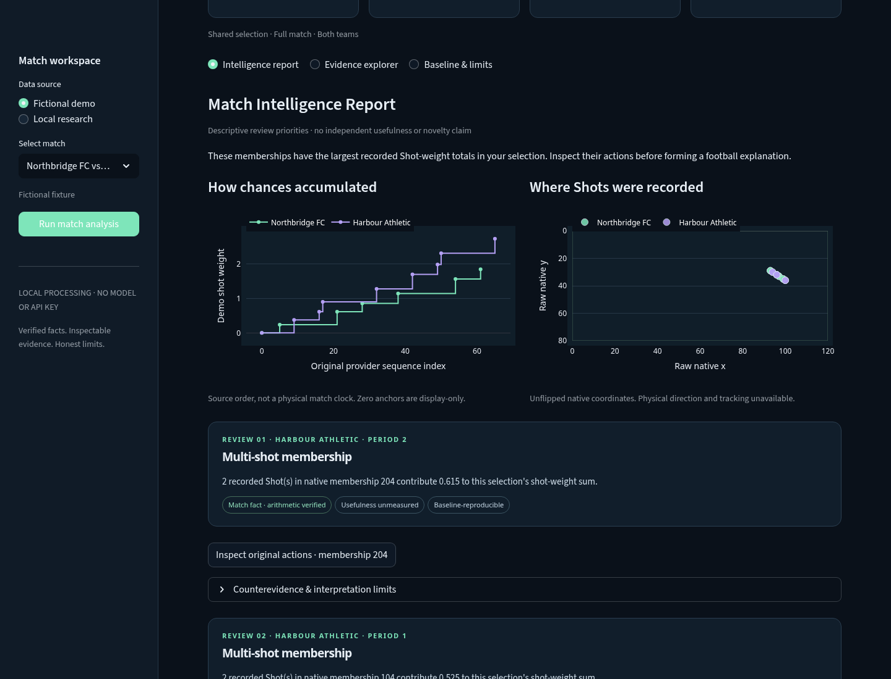

# FIL · Match Intelligence

**A working football analysis product that lets you inspect the evidence behind the report.**

Choose a match, compute its report, inspect original actions and challenge the interpretation.
FIL turns event records into bounded observations and review questions, with a conventional
statistics baseline alongside them. It never promotes an accurate calculation into a claim
of player ability or tactical causality.



*Screenshot of the running application, using fictional teams/actions only.*

## Standalone web frontend + Python API

A public-safe, synthetic-only full-stack web version is implemented under `web/`.
Run `uv run --frozen python scripts/serve_public_web.py`, then open http://127.0.0.1:8650.
Discover fictional player-match records, open a player, and inspect original actions.
The existing match report remains available through **Match intelligence**. Player counts
describe one fictional match and are not ratings or cross-match identities.
[Release scope, validation and deployment evidence](docs/PUBLIC_WEB_RELEASE.md).
Verified synthetic deployment: **https://fil-public-alpha.vercel.app** (fictional records
only; no provider data). Identity, acceptance evidence and limitations are recorded there.

## Run in three commands

Requires [uv **0.12.23**](https://docs.astral.sh/uv/getting-started/installation/) and Python
**3.11.14** (uv can install it). No API key, dataset download, database or GPU.

```bash
uv python install
uv sync --frozen
uv run --frozen python -m fil.intelligence run
```

Open **http://127.0.0.1:8501**, choose one of three fictional matches and click
**Run match analysis**. All reports are computed from the selected actions at runtime.
Use `--port 8521` if the default port is occupied. The launcher binds loopback and
turns off usage telemetry; this is a local application, not a hosted service.

## Synthetic Scout Copilot

The standalone web app includes a rule-based scouting preview using a separate fictional
fixture. It links candidates to supporting and contrary actions and abstains on unsupported
requests. It does not call a model; see [product decisions](PRODUCT_DECISIONS.md), the
[benchmark](docs/benchmarks/scout-copilot/README.md), and [local analytics](docs/PRODUCT_ANALYTICS.md).
With the standalone web server running, check both desktop and mobile with:

```sh
uv run --frozen --group browser python scripts/check_scout_copilot_browser.py --browser /path/to/chromium
```

## What works

- Searchable match selection, explicit analysis execution and source verification feedback.
- A concise **Match Intelligence Report**, cumulative chance-weight chart and native Shot map.
- Team/period filters shared by report statistics, evidence and comparison tables.
- Review cards with original action IDs, whole native-membership context, comparison Shots,
  alternative interpretations and explicit uncertainty.
- Searchable event ledger, untouched JSON drilldown and complete comparison baseline.
- Four distinct evidence standards: **match fact / repeated pattern / explanatory hypothesis /
  general capability**. Unsupported scopes remain unvalidated; no-Shot selections abstain.
- Responsive desktop/mobile layouts and a downloadable **fictional-only** report JSON.
- An opt-in offline adapter for the existing authorized **64-match research corpus**.
  Provider data is not included or acquired by the application.

The difficult engineering is at the boundaries: immutable source identity, original-record
preservation, own-goal and shootout reconciliation, missingness, honest claim scope, content-based
cache invalidation and consistent state across an interactive report.

## Scientific honesty

This MVP is a **deterministic evidence-driven analysis application**, not an autonomous expert
or a generative-AI agent. It fits no model and needs no external AI service. Review priorities
use transparent Shot-weight accounting; they are **not football-importance or novelty scores**.
The full ledger can reproduce the facts. Independent usefulness, superior-to-human discovery,
stable player capabilities and causal explanations have **not** been demonstrated.

Fictional shot weights are hand-authored, uncalibrated demonstration values, **not provider xG**.
In authorized local research mode, weights come only from original StatsBomb xG. Raw coordinates
are never silently flipped; physical direction, tracking and certified minutes are unavailable.
All existing real matches are development-exposed.

## Verify it

```bash
uv lock --check
uv run --frozen ruff check .
uv run --frozen pytest -q
uv build
```

Tests use self-authored TEST_ONLY fixtures and need no provider data or network.
For the synthetic scouting and match-report browser check, start the standalone web server
and run `uv run --frozen --group browser python scripts/check_scouting_browser.py --browser /path/to/chromium`.
The deployable synthetic bundle can be verified without deploying:
`uv run --frozen python scripts/verify_public_alpha.py`.

For other Chromium checks and retained performance samples, see
[actual MVP verification](docs/MATCH_INTELLIGENCE_VERIFICATION.md).
No legacy startup speedup or independent football discovery is claimed.

## Project map

| Layer | Implementation |
|---|---|
| Interactive product | [`src/fil/intelligence/app.py`](src/fil/intelligence/app.py) — Streamlit + Plotly |
| Deterministic analysis | [`engine.py`](src/fil/intelligence/engine.py) — exact decimal accounting, scoped evidence |
| Source boundary | [`sources.py`](src/fil/intelligence/sources.py) — pinned existing adapters, hash checks, no acquisition |
| Reusable foundation | Ingestion, canonical Parquet, score, possession and research modules under `src/fil/` |
| Verification | Offline regression suite, separate rational-arithmetic source checker, real Chromium scripts |

[Architecture & integration strategy](docs/MATCH_INTELLIGENCE_ARCHITECTURE.md) ·
[90-second demonstration & acceptance checklist](docs/MATCH_INTELLIGENCE_DEMO.md) ·
[Local research setup & rights](docs/MATCH_INTELLIGENCE_LOCAL.md) ·
[Resume-ready achievements](docs/MATCH_INTELLIGENCE_PORTFOLIO.md)

## Data rights and delivery status

FIL's code is [MIT licensed](LICENSE). Provider data is **not** relicensed by this repository.
Only self-authored synthetic screenshots belong in a public portfolio. Real records, derived
reports and screenshots stay local and ignored; no third-party sharing or public real-data
service is authorized. See [source policy](docs/SOURCE_POLICY.md).

The MVP is developed on `feat/fil-match-intelligence-mvp` from verified PR #22. Historical draft
PRs remain intact and unmerged; this branch does not silently integrate them into `main`.
Public deployment and historical integration still require owner authorization.

The earlier four-view Explorer remains available without behavioral changes:
[original setup and commands](docs/EXPLORER_SETUP.md),
[historical stabilization evidence](docs/STABILIZATION_REPORT.md),
[Master Reference](docs/Football_Intelligence_Lab_Master_Reference.md),
[Engineering Handbook](docs/Football_Intelligence_Lab_Engineering_Handbook_v3.0.md).
