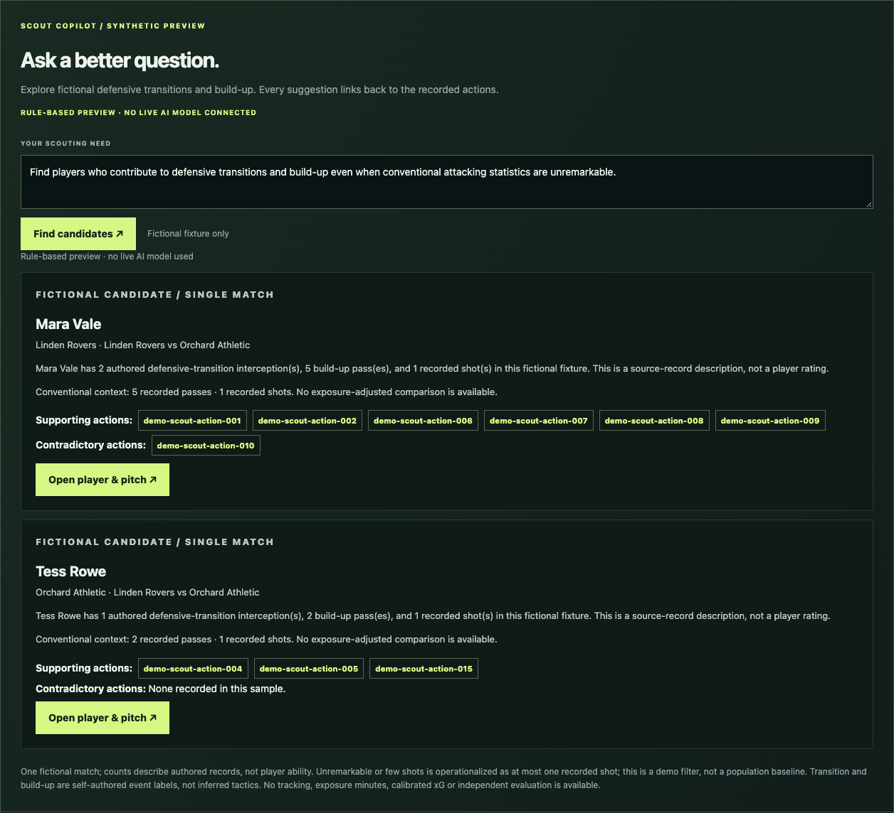
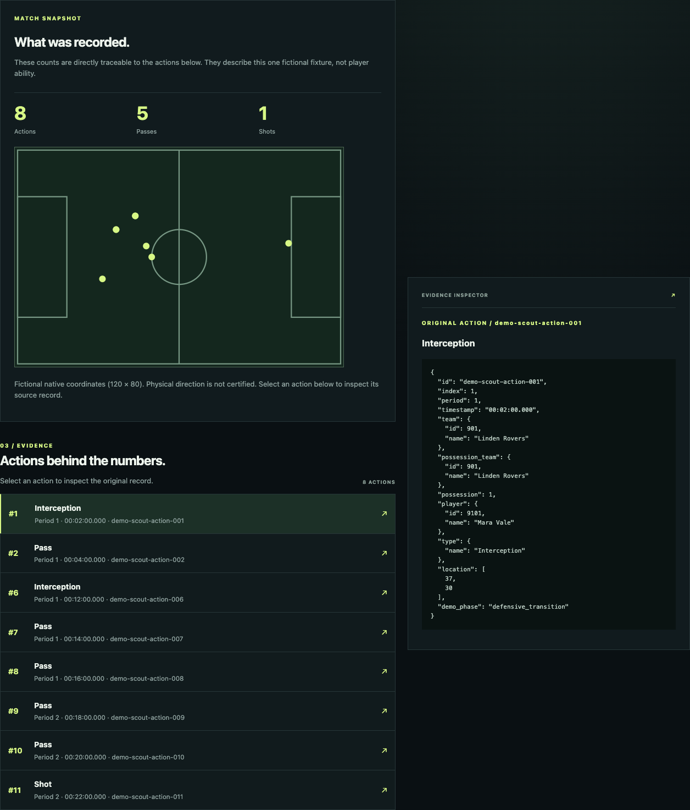
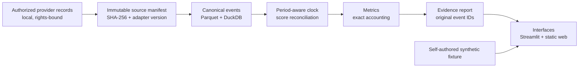

# Football Intelligence Lab

**Find the players whose important work does not show up in goals and assists.**

A source-traceable football scouting workspace: ask a scouting question, get candidates, and open
the exact events behind every claim. Python analysis, a dependency-free web client, a synthetic
demo that needs no credentials, and an evidence model that refuses to turn a small sample into a
player rating.

[Live synthetic demo](https://fil-public-alpha.vercel.app) ·
[Match Intelligence](https://fil-public-alpha.vercel.app/match.html) ·
[Research result](#research-result) ·
[Architecture](#architecture) ·
[Verification](#verification) ·
[Portfolio notes](docs/MATCH_INTELLIGENCE_PORTFOLIO.md)

[](https://github.com/Qiao527/football-intelligence-lab/actions/workflows/ci.yml)
[](pyproject.toml)
[](LICENSE)



> **Synthetic alpha.** The public demo uses self-authored fictional players and actions. It sends no
> provider data, needs no credentials and runs no model. That boundary is deliberate:
> [data rights and limits](#data-rights-and-limits).

## The question this project answers

Conventional scouting counts reward goals, assists and shots. The work that changes matches often
happens elsewhere: the interception before the counter, the third pass in the build-up. This project
makes that work inspectable, and refuses to promote a small sample into a player rating.

The default demo request is: *"Find players who contribute to defensive transitions and build-up
even when conventional attacking statistics are unremarkable."* It returns candidates with
supporting and contradictory actions; every event ID opens the original record.

**60-second tour for reviewers:** open the [live demo](https://fil-public-alpha.vercel.app), click
**Find candidates**, then open **demo-scout-action-010** under *Contradictory actions*. You are
looking at a product that shows its counter-evidence instead of hiding it.

## 23-second walkthrough


Find candidates -> contradictory action -> original JSON -> Match Intelligence.
[MP4 version](docs/images/demo.mp4) · [Live demo](https://fil-public-alpha.vercel.app)

## What is in it

| Surface | What it does |
|---|---|
| Discovery → player → evidence | Every count links to the original action JSON; no orphan numbers |
| Scout Copilot | Bounded, rule-based request interpretation; abstains on unsupported comparisons or attributes |
| Match Intelligence | Shot map, cumulative chance weight, period/team filters, comparison ledger and no-shot abstention |
| Local journey measurement | Opt-in, in-browser timing of discovery → evidence; never uploads search text or player IDs |

The public app is one synthetic fixture set. Real match IDs are rejected with HTTP 400 by design.



## Research result

A frozen scouting study asks two questions before any ranking is allowed: is the
underlying quantity stable enough per player to rank, and does a richer metric add
information beyond goals?

| Stage | Sample | Result |
|---|---|---|
| One tournament, one-appearance criterion | 63 matches, 377 pairs | ceiling 0.436 < 0.45, **stop** |
| Three leagues, 14 appearances per window | 1,140 matches, 960 players | ceiling 0.856, **proceed** |
| Held-out league | 377 matches, 320 players | xG − goals **+0.061**, **replicated** |

Rank correlation with the next window's xG per appearance: goals 0.741, source xG
0.791. The increment is real, replicated, and still below the pre-declared 0.10
worthwhile difference — detectable, not decision-grade.

Thresholds, arms, priors and endpoints were frozen before the data was opened; the
held-out league was fetched only after the code freeze, and the confirmation script
exposes no tunable argument. No player label, shortlist or ability score is produced.
[Full summary](docs/research/SCOUTING_RESEARCH_SUMMARY.md) ·
[Protocol](docs/research/LEAGUE_SCOUTING_PROTOCOL.md) ·
[Replication](docs/research/LEAGUE_CONFIRMATION_RESULT.md) ·
[Explorer UI notes](docs/EXPLORER_UI.md)

## Try it

Live, no setup: **https://fil-public-alpha.vercel.app** (fictional data only).
The earlier `fil-match-intelligence.vercel.app` domain is a separate archived demo from
another repository and is not this project.

Local web app (pinned tooling; requires [uv 0.12.23](https://docs.astral.sh/uv/getting-started/installation/)):

```bash
uv python install
uv sync --frozen
uv run --frozen python scripts/serve_public_web.py
# http://127.0.0.1:8650
```

Local match report (Streamlit):

```bash
uv run --frozen python -m fil.intelligence run
# http://127.0.0.1:8501
```

Tests, lint and the deployable artifact:

```bash
uv run --frozen ruff check .
uv run --frozen pytest -q
uv run --frozen python scripts/verify_public_alpha.py
```

## Architecture



Two tracks share one analysis core. The public artifact is a 26-file allowlisted bundle with only
synthetic data; the real research corpus never leaves the local, rights-bound track.

## Engineering decisions worth discussing

- **Identity before interpretation.** Raw provider files are immutable, recorded with URL, fetch
  time, SHA-256, rights note, adapter version and commit. Original event IDs, period, sequence and
  coordinates are preserved; a missing metric is `null`, never `0`.
- **Time is not a minute counter.** Period-aware clocks distinguish stoppage time, extra time and
  shootouts. Scores are reconciled against source metadata, with own goals and penalties treated as
  separate cases rather than folded into a player's tally.
- **Team is not possession team.** Both are kept distinct through canonicalization, scoring and
  presentation, because defensive-transition analysis depends on the difference.
- **Claims have levels.** Every statement is a match fact, repeated pattern, explanatory hypothesis
  or general capability. Unsupported selections abstain. Shot weights are accounting, not a novelty
  score, and the UI says so.
- **The public artifact is an allowlist, not the repository.** `scripts/package_public_web.py`
  copies exactly 26 reviewed files; CI rebuilds the bundle, compares it byte-for-byte with the
  committed manifest, imports every serverless entrypoint in isolation and exercises the HTTP
  contract. `scripts/check_deployment.py` repeats the contract against a deployed URL and rejects
  platform 404s, missing evidence and abstention.
- **AI is a boundary, not a badge.** The deployed app runs no model. Provider adapters in
  `src/fil/` are restricted to fixed synthetic prompts, validated locally and excluded from the
  public bundle. The next step is a measured comparison against the rule baseline — not a chat box.

## Verification

| Command | What it proves |
|---|---|
| `uv run --frozen ruff check .` | Lint and import ordering |
| `uv run --frozen pytest -q` | 760 offline tests; no network, no provider data |
| `uv run --frozen python scripts/verify_public_alpha.py` | 26-file manifest match, isolated entrypoints, HTTP contract |
| `uv run --frozen python scripts/check_deployment.py --url <url>` | Live acceptance: identity, candidates, fixture, discovery page |
| `uv run --frozen python scripts/check_scout_copilot_browser.py --browser <chrome>` | Chromium journey at 1440x900 and 390x844 |

Current evidence: 760 tests pass, the packaged bundle matches its manifest, and the synthetic
deployment at `fil-public-alpha.vercel.app` passed the HTTP and Chromium acceptance run. Deployment
identity is recorded by source-tree hash, because a CLI deployment reports no commit metadata.

## Project map

| Layer | Where |
|---|---|
| Public web client + Python API | [`web/`](web/) |
| Product, engine and source boundary | [`src/fil/intelligence/`](src/fil/intelligence/) |
| Ingestion, canonical events, clock, score, possessions, research | [`src/fil/`](src/fil/) |
| Verification and release scripts | [`scripts/`](scripts/) |
| Scouting research protocols, executions and limits | [`docs/research/`](docs/research/) |
| Design, contracts and evidence reports | [`docs/`](docs/) |
| Tests | [`tests/`](tests/) |

Start with the [research summary](docs/research/SCOUTING_RESEARCH_SUMMARY.md),
[architecture](docs/MATCH_INTELLIGENCE_ARCHITECTURE.md), [metrics](docs/METRICS.md),
[source policy](docs/SOURCE_POLICY.md), [match clock](docs/MATCH_CLOCK.md) and
[release evidence](docs/PUBLIC_WEB_RELEASE.md).

## Data rights and limits

Code is [MIT licensed](LICENSE). Provider data is **not** included or relicensed. The public demo is
synthetic-only; the authorized 64-match research corpus (227,825 original events) stays local and
ignored, and is not redistributed.

Not claimed: player ability or rankings, causal tactical explanations, stable cross-match identities,
physical tracking, calibrated xG for synthetic records, model uplift or production performance of the
hosted workload. The demo demonstrates product and data-engineering decisions, not football truth.

## What I would build next

1. Decide whether public real-player analysis is licensed; if not, keep real analysis private.
2. Measure an AI-assisted interpreter against the rule baseline on held-out tasks, including cost,
   latency, abstention and unsupported claims.
3. Add an event-sequence replay and player involvement map, clearly labelled as event positions,
   not tracking.
4. Harden the public alpha: custom domain, rate limiting, monitoring and accessibility audit.
