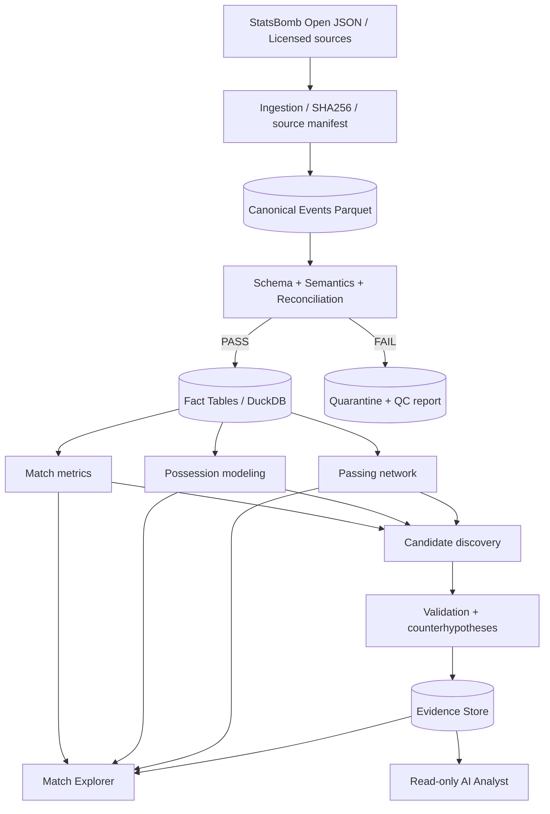
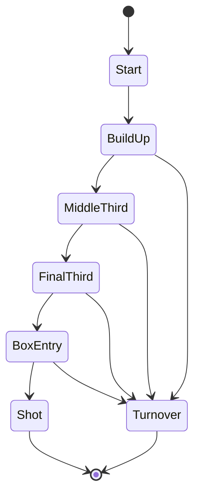
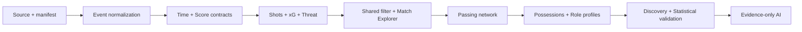
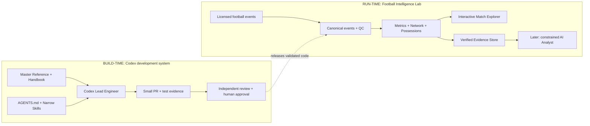

# Football Intelligence Lab — 工程技术实施参考手册

**Engineering Implementation Handbook v3.0 — Codex-first Edition**  
**编写日期：** 2026-10-18  
**适用范围：** FIL v0.3 → v1.0  
**升级依据：** 用户提供的 GitHub Stars 62 个仓库清单，以及官方 Codex 项目指令/Skills 文档（详见第 36 节）  
**基础文档：** `Football_Intelligence_Lab_Master_Reference.md`（2026-10-18，v1.0）  
**主要语言：** 中文；术语、代码、接口名使用英文  
**文件性质：** 可执行实施规格（Implementation Specification），不是已经完成的功能报告

> **工程使命**：先将每一场比赛还原为可交互、可追踪来源的事件与战术证据，再在严格的上下文调整和反证机制下研究球员及球队系统。
>
> **三条红线**：不得用历史比赛数据冒充新比赛；不得以事件坐标声称拥有 tracking；不得由 LLM 编造数值或将相关性写成因果。

---

> **v3.0 适用说明：** 本文件整合并保留 v2.0 对比赛数据与指标的工程契约；第 21 节已替换为 Codex 主责，第 26–36 节新增 Starred 技术评估、Codex 工作流、专用 Skills、风险审计及可直接用的任务 Prompts。文内所有 TODO、CLI/API 示例均为**技术要求**，并非已完成的实现或实测结果。

## 0. 阅读路径与交付定义

### 0.1 这份手册新增了什么

原 Master Reference v1.0 定义了**产品定位、研究问题、功能优先级与伦理边界**。本文不改变这些决策，而将它们落实为工程方案，重点解决以下原文未细化的问题：

1. **Source → Tables**：比赛 JSON 如何落盘、规范化、校验、按 ID 溯源。
2. **Event Semantics**：补时、半场、点球大战、乌龙球、坐标朝向、传球成功与球权究竟怎样解释。
3. **Metric Contracts**：各张图和每个指标的公式、样本分母、排除规则与缺失策略。
4. **Interaction Contract**：一处改选时间窗口，所有图如何更新且不混淆不同时间口径。
5. **Discovery Protocol**：怎样从候选规律到独立验证，避免挑选性叙述。
6. **Code & Quality**：目录结构、接口、CLI、测试、CI、数据发布门禁、性能预算。
7. **Codex-first Delivery**：Codex 担任主实现；仓库 AGENTS.md、专用 Skills、PR / 质量门禁、独立复核与人工签收。

### 0.2 本手册中的标记

- **[SOURCE]** 来自 Master Reference v1.0 的已定决策。
- **[VERIFIED DOC]** 来自可核对的外部官方代码/文档；不表示已实际运行。
- **[DESIGN]** 新提出的工程决策，需通过测试和用户验收。
- **[GATE]** 通过前禁止进入下一阶段的门槛。
- **[RESEARCH]** 需要跨比赛、实证验证、可能被证伪的研究性假设。

### 0.3 首个闭环（必须先做）

**指定比赛：** 2018 FIFA World Cup Final，France vs Croatia，StatsBomb `match_id=8658`（沿用原始参考中的 v0.2 示例）。**只作为历史方法开发基准，不作为 2026 年任何球队实时分析。**

最低交付闭环：

```text
open-data events/8658.json
    ↓ source manifest + SHA256
canonical_events.parquet
    ↓ contract checks
shots.parquet + match_timeline.parquet + xg_cumulative.parquet
    ↓ shared filters
Match Explorer (overview / timeline / xG / shots / evidence drilldown)
    ↓ acceptance test
任何图点 → source event_id → 完整 raw JSON
```

**成功不是“出现漂亮图表”，而是：** 任意点击一个球员/射门/时间段，都能核查其数据与含义；可证明前后端时间筛选结果与原始事件一致。

---

## 1. Architecture Decision Records（架构决策）

| ADR | 决策 | 原因 | 后续切换条件 |
|---|---|---|---|
| ADR-001 | Python 为计算主语言 | 与 socceraction / NetworkX / 科学统计生态匹配 | 不切换分析核心 |
| ADR-002 | **原始 JSON 永不覆盖**，Parquet 为规范化事实层 | 可复现、可版本化、快速扫描 | 源文件按版本存档 |
| ADR-003 | DuckDB + Parquet 起步，无需 PostgreSQL | 单人/小团队的比赛批处理和 OLAP 足够 | 并发写入/权限/多用户评论需求显著时迁移 |
| ADR-004 | Streamlit + Plotly + mplsoccer 做 v0.3–v0.4 | 快速完成联动、审核分析 | 复杂的跨图框选 / 商业 UX 被实际证明需要时再做 React/Next.js |
| ADR-005 | 计算层与 UI 严格分离 | 同一指标供 CLI、Notebook、UI、Agent 使用 | 长期保留 |
| ADR-006 | 所有指标定义版本化 | xT/possession/归因规则改变会影响结论 | 长期保留 |
| ADR-007 | 只有通过 Data Quality Gate 的比赛能对外发布 | 避免“看上去合理”的错误指标 | 长期保留 |
| ADR-008 | v0.3 使用提供方的 `statsbomb_xg`，**不训练自制 xG** | 少一个可控误差源；先建立比赛事实 | v0.6 后另开模型实验 |
| ADR-009 | Agent 只读经验证的 Evidence Store | 语言推论不得替代统计 | 长期保留 |
| ADR-010 | 暂不开发实时采集/直播视频分析 | 许可证、时间同步、基础工程均未具备 | 获得授权事件流并完成静态版门禁后 |

**非目标（到 v0.4 前）：** 22 人连续位置重建、实时比赛、个性化球员万能评分、自动识别球员“划水”、精确视频时码、自由生成 SQL 的 AI Agent。

---

## 2. 系统结构与模块边界



### 2.1 边界接口

- `ingestion`: 仅负责读取、保留原始来源和提供稳定事件字段；**不下战术结论**。
- `metrics`: 输入 DataFrame / 规范化表，输出有定义的事实表；**不依赖 Streamlit**。
- `possessions`: 一条球权（`(match_id, possession_id)`）及其动作链；定义版本独立保存。
- `networks`: 输入已筛选、已验证的传球数据，输出节点/有向边及模型元数据。
- `discovery`: 扫描候选并生成研究任务；**不能将标签变为最终评价**。
- `validation`: 控制样本、角色与比赛情境；输出证据与反证。
- `app`: 只负责选择状态、渲染图表、跳转源事件。
- `agent`: 使用受限只读函数和 Evidence Store；不能直接改表或补造缺失行。

### 2.2 推荐目录（与 v1.0 兼容，细化目录）

```text
football-intelligence-lab/
├── README.md
├── pyproject.toml                # 依赖范围；锁文件另存
├── uv.lock                      # 或 requirements-lock.txt，二选一
├── .env.example
├── .gitignore
├── config/
│   ├── competitions.yml
│   ├── metrics.yml              # 公式、过滤口径与版本
│   └── fixtures.yml             # 8658 等回归比赛
├── data/
│   ├── raw/statsbomb/<match_id>/events.json
│   ├── raw/statsbomb/<match_id>/metadata.json
│   ├── interim/events/match_id=<id>/*.parquet
│   ├── interim/possessions/match_id=<id>/*.parquet
│   ├── processed/<table>/match_id=<id>/*.parquet
│   ├── manifests/<match_id>.json
│   └── quarantine/
├── src/fil/
│   ├── cli.py
│   ├── ingestion/{fetch.py,normalize.py,schema.py,manifest.py}
│   ├── time/{clock.py,periods.py}
│   ├── metrics/{shots.py,xg.py,threat.py,score.py}
│   ├── possessions/{extract.py,flows.py}
│   ├── networks/{passes.py,graphs.py,resilience.py}
│   ├── analysis/{roles.py,baselines.py}
│   ├── discovery/{generate.py,filters.py}
│   ├── validation/{checks.py,bootstrap.py,audit.py}
│   ├── store/{query.py,provenance.py}
│   └── agent/{tools.py,claims.py}
├── app/{Home.py,pages/,components/,state.py}
├── tests/{unit/,integration/,regression/,fixtures/}
├── sql/{views.sql,quality_checks.sql}
├── scripts/{bootstrap.sh,build_match.sh}
├── reports/{qc/,evidence/,figures/}
├── docs/{metric_dictionary.md,source_policy.md,ADRs.md}
└── .github/workflows/ci.yml
```

> 注意：这是一套**目标目录**，不等于用户现有仓库已经具备这些文件。允许先用更少的模块实现；不允许抹掉功能间的边界。

---

## 3. 技术栈、环境与版本策略

### 3.1 最小必要依赖

| 分类 | 必需 | 阶段 | 为什么 |
|---|---|---|---|
| 语言 | Python 3.11 或 3.12（先固定一个） | v0.3 | 依赖兼容性好；不要追求最新版本 |
| DataFrame | pandas, numpy, pyarrow | v0.3 | JSON → Parquet、事件聚合 |
| OLAP | duckdb | v0.3 | 直接对 Parquet 查询，支持列与过滤下推 |
| UI | streamlit, plotly | v0.3 | dashboard / 统一时间筛选 |
| 球场图 | mplsoccer, matplotlib | v0.3 | 精确 provider pitch 类型 |
| 质量 | pytest, ruff, mypy（逐步） | v0.3 | 回归与基本静态检查 |
| Action model | `socceraction[statsbomb]` | v0.4/0.5 | SPADL、xT、VAEP 方法复用 |
| Graphs | networkx | v0.4 | 有向图与网络压力测试 |
| Stats | scipy, statsmodels | v0.5/0.6 | bootstrap、同角色对比 |
| Process mining | 自研；PM4Py 可选 | v0.6 | 仅在 possession 已稳定时引入 |
| LLM | 一种 API + JSON Schema 校验 | v0.7 | 基于证据生成研究报告 |

**锁版本的正确方式：** 先建立兼容环境，在该机器上跑通 8658 fixture，生成完整 lockfile 并提交；不应凭本文随意声称某个尚未安装测试的版本组合已经稳定。

**首次环境命令（示例）：**

```bash
python -m venv .venv
# macOS/Linux
source .venv/bin/activate
# Windows PowerShell: .venv\Scripts\Activate.ps1
python -m pip install --upgrade pip
python -m pip install pandas numpy pyarrow duckdb streamlit plotly mplsoccer matplotlib pytest ruff
python -m pytest -q
```

随后写入 `pyproject.toml`、lockfile；CI 必须使用锁文件重现，不得用不设上限的浮动生产依赖。

### 3.2 为什么现在不是复杂微服务

在少量静态历史比赛上，用独立的 Python CLI 构建 Parquet，并由 Streamlit 只读查询即可。微服务、Kafka、实时数据库、向量数据库、GPU、Kubernetes 均**不是 v0.3 的必要条件**。需要频繁新数据更新或并发用户显著增加时再测量扩展。

---

## 4. 数据获取、来源证明与权限

### 4.1 [VERIFIED DOC] 公开数据组织

StatsBomb/Hudl Open Data 仓库包含 `competitions.json`、`matches/<competition>/<season>.json`、`events/<match>.json`、`lineups/<match>.json`；`three-sixty/<match>.json` 仅在部分比赛存在。其 README 要求发布基于这些数据的研究/成果时标明 StatsBomb 并使用提供的 logo。**公开可读不等于对任意商业再发布无限授权，发布产品前审阅当时有效许可。**

- 仓库：https://github.com/hudl/open-data
- README：https://github.com/hudl/open-data/blob/master/README.md
- 技术文件：https://github.com/hudl/open-data/tree/master/doc

**v0.3 固定输入（示例）：**

```text
https://raw.githubusercontent.com/hudl/open-data/master/data/events/8658.json
```

可将赛事元信息另外从 `matches/43/3.json` 保存；**metadata 需实取源文件，不能从文件名推断球队、比分、日期、赛事名字。**

### 4.2 下载行为

- 允许从官方开放数据路径做受控获取，优先**本地缓存**；不要向商业网站进行未经许可的批量爬取。
- 下载原始字节到临时路径 → 校验 JSON/HTTP 状态 → 计算 SHA-256 → 原子写入 `data/raw`。
- 若同一个 match_id 的来源字节哈希变化，**存成新 source_revision**，绝不静默覆盖先前结果。
- 将下载时间（UTC）、最终 URL、match_id、source_revision、metadata 版本、条款链接、哈希、字节数写入 manifest。
- raw data 不作为任意公共发行包的一部分；部署时评估 redistribution 权利、使用缓存或仅发布允许的数据视图。

```json
{
  "source": "statsbomb_open_data",
  "match_id": 8658,
  "source_revision": "sha256:<actual digest>",
  "retrieved_at_utc": "<runtime-generated ISO8601>",
  "source_url": "https://raw.githubusercontent.com/hudl/open-data/master/data/events/8658.json",
  "source_sha256": "<actual digest>",
  "event_count_raw": null,
  "license_or_terms_url": "https://github.com/hudl/open-data/blob/master/README.md",
  "normalizer_version": "0.1.0",
  "metric_spec_version": "fil-metrics-0.1.0",
  "quality_status": "pending"
}
```

以上带尖括号、`null` 的字段是**模板占位符**，不能被当成真实的数据值。

### 4.3 数据源隔离规则

`source`、`source_revision`、`match_id` 一起决定数据血缘。StatsBomb 历史事件与 FotMob/Sofascore 当天汇总不允许直接 join 成貌似同一套 `event_id`。当数据源不同、比赛 ID 体系不同、xG 模型不同：须保留并标注源身份，且默认**不把 xG 数值当可比指标**。

---

## 5. Canonical Event Model（最重要的工程基础）

### 5.1 原始与规范化一一对应

**主键：** `(source, match_id, event_id)`。`index` 用于同场原始事件先后顺序；同时间戳不代表唯一事件。以 `period, index` 做稳定排序（具体比较原数据顺序与索引后锁定）。**严禁**仅靠时间戳生成事件 ID。

必要字段：

| 字段 | 类型 | 规则 |
|---|---|---|
| `source`, `source_revision` | string | 不为空；manifest 对得上 |
| `match_id`, `competition_id`, `season_id` | int/str | provider ID 原样保留，其他层可另有 canonical key |
| `event_id` | string | 原始 `id`；同源同场唯一 |
| `provider_index` | int | 原始 `index`；允许时间戳重复 |
| `period` | int | 1/2 常规上下半场；3/4 加时；5 点球大战 |
| `provider_minute`, `provider_second` | int | 原始比赛钟，不能代替物理流逝时间 |
| `period_timestamp` | string | 原始 `HH:MM:SS.mmm` |
| `period_elapsed_s` | float | 从 period timestamp 解析；避免浮点分秒拼错 |
| `chronological_s` | float | 推导的连续比赛轴（规则见 §6） |
| `team_id/name`, `player_id/name` | nullable | `Starting XI` / `Half Start` 等可无 player |
| `possession_id`, `possession_team_id` | nullable | **不能等同于每条事件的行动球队** |
| `event_type`, `play_pattern` | string | 来自原始对象 `name` |
| `x`, `y`, `end_x`, `end_y` | nullable float | StatsBomb 坐标，保留原始坐标系说明 |
| `recipient_player_id` | nullable | 仅 pass 类型相关 |
| `pass_outcome` | nullable | null 语义需限定在 Pass 事件 |
| `shot_xg`, `shot_outcome`, `shot_type` | nullable | 仅 Shot 使用；不推断漏值为 0 |
| `under_pressure` | nullable bool | 未出现表示缺失/未标注条件，不能必然解释为无压迫 |
| `duration_s`, `related_event_ids` | nullable | 保留用于审核 |
| `raw_event_path` | string | 指回 raw 文件/包；配合 id 定位 |
| `normalizer_version`, `quality_flags` | string/list | 扩展和追踪 |

**注意：** provider 出现部分无 player 的事件并非脏数据；坐标可缺失，也不能填 `(0,0)`。`NaN` 不等于 0。

### 5.2 最小规范化函数契约

```python
from typing import Any


def nested(obj: dict[str, Any], *path: str) -> Any:
    cur: Any = obj
    for key in path:
        if not isinstance(cur, dict):
            return None
        cur = cur.get(key)
    return cur


def xy(value: Any) -> tuple[float | None, float | None]:
    if not isinstance(value, list) or len(value) < 2:
        return None, None
    return float(value[0]), float(value[1])


def normalize_event(e: dict[str, Any], match_id: int) -> dict[str, Any]:
    x, y = xy(e.get("location"))
    event_type = nested(e, "type", "name")
    subtype = "pass" if event_type == "Pass" else (
        "shot" if event_type == "Shot" else None
    )
    details = e.get(subtype, {}) if subtype else {}
    end_x, end_y = xy(details.get("end_location"))
    return {
        "match_id": match_id,
        "event_id": e["id"],
        "provider_index": e["index"],
        "period": e["period"],
        "period_timestamp": e["timestamp"],
        "provider_minute": e["minute"],
        "provider_second": e["second"],
        "event_type": event_type,
        "team_id": nested(e, "team", "id"),
        "team_name": nested(e, "team", "name"),
        "player_id": nested(e, "player", "id"),
        "player_name": nested(e, "player", "name"),
        "possession_id": e.get("possession"),
        "possession_team_id": nested(e, "possession_team", "id"),
        "play_pattern": nested(e, "play_pattern", "name"),
        "x": x, "y": y, "end_x": end_x, "end_y": end_y,
        "recipient_player_id": nested(e, "pass", "recipient", "id"),
        "pass_outcome": nested(e, "pass", "outcome", "name"),
        "shot_xg": nested(e, "shot", "statsbomb_xg"),
        "shot_outcome": nested(e, "shot", "outcome", "name"),
        "shot_type": nested(e, "shot", "type", "name"),
        "under_pressure": e.get("under_pressure"),
        "duration_s": e.get("duration"),
        "related_event_ids": e.get("related_events", []),
    }
```

**代码状态：** 上述是有明确输入/输出的**核心示例，不是成品下载/验证流水线**；还需注入 `source_revision`、时钟、质量 flags、manifest 和 Parquet 写入逻辑。原始嵌套字段不覆盖，只提取分析需要的规范化列。

### 5.3 规范化不意味着删掉原始语义

- `pass`、`shot`、`goalkeeper`、`foul` 的子结构按需新增专门事实表或 JSON 视图。
- `related_events` 不是严格时序父子关系，不可直接解释为动作因果链。
- `under_pressure` 仅为该数据源的一种事件属性，不能算作完整压迫事件总量。
- 比赛原始 event 与 SPADL **action** 不是一回事：后者是标准化球员动作子集，必须另建 `actions_spadl` 并保留原事件映射。

---

## 6. 时间工程：半场、补时、加时、点球大战

**[GATE] FIL 能否可信，首先取决于这部分。** StatsBomb 的 `minute` 可能跨期延续，而 `timestamp` 表示某个 period 内经过的时间；单纯 `minute*60 + second` 容易使上半场补时与下半场时间轴重叠。正确的模型至少分三种钟：

1. `period_elapsed_s`：从单个 period 起点累计，例如下半场第 3 分钟是约 180 s。
2. `chronological_s`：用于绘图排序的**连续比赛事件轴**。第 2 period 的起点等于第 1 period 实际事件持续时长，非硬编码 2700 秒。
3. `display_clock`：观众看到的 `45+2'`、`90+3'` 等，不是连续轴的浮点数格式。

### 6.1 连续轴构造（推荐算法）

```python
# 以 e['period'], e['timestamp'] 为最可靠的排序锚点之一。
# 1. 在每个 period 内把 HH:MM:SS.mmm 转为秒。
# 2. 得到各 period 的 period_end_s（优先使用 Half End 事件的 elapsed）。
# 3. period_offset[p] = sum(duration of all periods before p)。
# 4. chronological_s = period_offset[period] + period_elapsed_s。
# 5. 不把 period=5 的点球大战与运动比赛 xG 放在同一时间轴。
```

`period_end_s` 缺失：数据标记 `period_end_estimated=true`；可用该段最大可见时间作为**有条件估计**，不得误称为精确的物理比赛时间。对 `Half Start` / `Half End` 事件做专项测试。忽略中场现实休息时长，故 `chronological_s` 表示**比赛阶段事件时间轴**，非真实世界经过秒数。

### 6.2 时间窗口规范

不能只存 `start_minute=45,end_minute=60`。**推荐稳定查询对象：**

```json
{
  "match_id": 8658,
  "periods": [2],
  "period_elapsed_start_s": 0,
  "period_elapsed_end_s": 900,
  "include_start": true,
  "include_end": false,
  "penalty_shootout": "exclude"
}
```

该对象精确定义「下半场开局 15 分钟」，避免上半场 45+ 时刻误入。若用户在连续时间线上刷选，可以保存 `chronological_start_s/end_s`，再转换为 period-aware filter；底层 SQL 仍应保持统一左闭右开 `[start,end)`。最后一个 period 的 terminal marker 例外必须另定。

### 6.3 标记补时与加时

- 上半场：常规 `0–45`；若出现超过 45 分钟的第一段，展示 `45+N`（具体秒保留在 tooltip）。
- 下半场：常规 `45–90`；超过 90 展示 `90+N`。
- Period 3 / 4：加时赛属于**运动比赛时间**，但常规 90 分钟报表应单独显示与纳入选项。
- Period 5：点球大战的每次射门应展示在单独 Penalty Shootout 层，默认**从常规/加时 xG 中排除**。
- Match Explorer 切换成“上半场/下半场/常规全场/含加时”时，时间轴和 KPI 需要展示所用时间域。

### 6.4 必测边界

`44:59.9`、`45+2`、第二段 `45:00`、`89:59`、`90+5`、`90:00` 加时首段、同一秒不同 index、Half End 缺失、点球大战、比赛期数据不连续、负时间/异常时间。**禁止**拿一个固定 `0–95 min` 滑杆默默混淆上述含义。

---

## 7. 坐标与运动方向

### 7.1 坐标真值

[VERIFIED DOC] `mplsoccer.Pitch(pitch_type='statsbomb')` 使用 StatsBomb 120 × 80 坐标，默认 y 轴朝向和普通笛卡儿图表不同。**所有显示和指标须声明坐标域**：

- `raw_statsbomb_120x80`：provider 原始事件坐标。
- `action_attacking_ltr`：适于传球/射门/推进的执行球队进攻方向归一化视图。
- `world_fixed`：物理球场朝向（**仅有事件流未必能恢复**，需要授权 tracking 或可靠元信息）。
- `spadl_105x68`：socceraction action 层使用的归一化足球场尺寸（保留 conversion 说明）。

**重要：** StatsBomb 的 action 执行方通常沿 x 正方向进攻；但仍需针对每一数据源/版本查实方向约定。不要对 StatsBomb 已经归一化的坐标再次根据主客场或半场随意 flip，否则进攻线路会反转。

**推荐 MVP：** 画两队各自进攻的标准化「向右进攻」图；当同图叠加两队路线时，明确图是 **team-relative**，不能误称为真实同一时刻的绝对位置。

### 7.2 显式转换函数

```python
def statsbomb_to_normalized(x: float, y: float) -> tuple[float, float]:
    if not (0 <= x <= 120 and 0 <= y <= 80):
        raise ValueError("out-of-bounds StatsBomb coordinate")
    return x / 120.0, y / 80.0
```

不允许将 x=100 的 StatsBomb 与 x=100 的 SPADL 当成相同空间位置。每个图表 `coordinate_system` 字段应可见。

---

## 8. 事实表与数据仓库：Schema v0.3

### 8.1 表级清单

| 表名 | 粒度 | 主键 | 用途 |
|---|---|---|---|
| `source_manifest` | match × revision | `(source,match_id,revision)` | provenance/许可/哈希 |
| `matches` | match | `(source,match_id)` | 时间、球队、赛事、比分 |
| `canonical_events` | event | `(source,match_id,event_id)` | 可审核事实源 |
| `match_timeline` | timeline-worthy event | `(match_id,event_id)` | 进球、牌、换人、射门等 |
| `shots` | Shot event | `(match_id,event_id)` | xG、地图、射门结果 |
| `xg_cumulative` | team × timeline point | `(match_id,team_id,sequence_key)` | 累计 xG 曲线 |
| `window_threat` | team × window | `(match_id,team_id,window_id,metric_version)` | 透明 momentum 替代 |
| `possessions` | possession | `(match_id,possession_id)` | 动作链、起点、终点、终结 |
| `possession_actions` | event/action × possession | `(match_id,possession_id,event_id)` | 流程研究 |
| `pass_edges` | passer→recipient × filter | `(match_id,window_id,team,source_player,target_player)` | 传球网络 |
| `metric_runs` | metric × run | `run_id` | 参数/版本/输入哈希 |
| `research_findings` | hypothesis | `finding_id` | 证据、反证、状态 |

**Parquet 与 DuckDB 的角色：** parquet 是事实文件，DuckDB 可以直接查询 Parquet，也可以把常用索引/宽表导入本地数据库。数据规模小不必双份存储；如果存 DuckDB，指明哪一处是 source of truth，禁止双向修改。

### 8.2 `shots` 字段

```text
match_id, event_id, period, period_elapsed_s, chronological_s,
team_id, player_id, raw_x, raw_y, xg, outcome, shot_type,
body_part, under_pressure, is_penalty, is_shootout,
play_pattern, provider_index, raw_event_ref,
metric_spec_version, source_revision
```

`is_penalty`（运动比赛中的点球）与 `is_shootout`（点球大战）是**两个不同字段**。默认全场 xG：包含常规比赛中的点球射门；不包含 period=5 的 shootout。还应为不含运动比赛点球的 `non_penalty_xg` 单独输出，避免混称。

### 8.3 `matches` / scoreboard 的规则

- 普通进球来自 `Shot` 的 `shot.outcome.name == 'Goal'`，其中常规或加时点球属于正常进球。
- `Own Goal For` / `Own Goal Against` 可能是同一乌龙球的两个相关事件，**不能简单加两次**。建立 own-goal scorer attribution、关联、去重规则，并与官方 meta 最终比分核对。
- `period=5` 是点球大战，不计入运动比赛比分；另建 `shootout_score`。
- 如同场官方比分与事件得分不同，置 `score_reconciliation_failed`、阻止发布，不可“手工修成一致”而丢掉痕迹。
- 球队事件总数不等于持球队伍动作数：`possession_team` 与 `team` 是不同含义。

### 8.4 事实表的数据契约

每个产物元数据包含：`source_revision`、`pipeline_git_sha`、`normalizer_version`、`metric_version`、`time_domain`、`coordinate_system`、`input_row_count`、`output_row_count`、`null_summary`、`generated_at_utc`、`validation_status`、`known_limitations`。

将 metrics 元数据写成可比对 JSON 或 YAML 规范（例如定义“威胁”到底是 xG/窗口还是 xT/动作）。**无版本字段的旧报告不得被默默覆盖为新结果。**

---

## 9. v0.3 四个核心计算模块

### 9.1 `match_timeline`

**输入** `canonical_events`；筛出进球、乌龙球、黄/红牌、换人、射门、Half Start/End，可选 decisive actions。重要事件按 `(period,provider_index)` 排序。每条输出 `icon_category`, `display_clock`, `team_id`, `player_id`, `event_id`, `narrative_label`, `source_ref`。

**不要**仅仅输出「第 18 分钟进球」，必须区分 own goal、点球、乌龙球归属。球员红牌可能由 `Foul Committed` / `Bad Behaviour` 的 card 子字段承载，需建立字段映射。

### 9.2 `shots` + `xg_cumulative`

**xG 总计：**

\[
XG_{team}(W)=\sum_{i \in Shots(team)\cap W} xG_i
\]

其中各射门的 `xG_i` 来自 provider 提供的 `shot.statsbomb_xg`。默认统计空间是运动比赛（排除 period=5），包含运动比赛中的 penalty；单独提供 non-penalty 版本。

**累计曲线**：只在有效 Shot 事件更新。为了在两队共用时间轴显示真实阶梯曲线，每队都必须有 xG 从 0 起始的 step series，并在换边等节点之后延续前值。`xg_cumulative` 可为 shots-only source series，图形层补 anchor/hold 点，不能将假锚点当原始射门。

```python
import pandas as pd


def build_shots(events: pd.DataFrame) -> pd.DataFrame:
    shots = events.loc[
        (events["event_type"] == "Shot") & (events["period"] != 5)
    ].copy()
    if shots["shot_xg"].isna().any():
        raise ValueError("missing provider xG for match-play Shot")
    if not shots["shot_xg"].between(0.0, 1.0).all():
        raise ValueError("xG out of probability bounds")
    return shots.rename(columns={"shot_xg": "xg"})


def build_xg_cumulative(shots: pd.DataFrame) -> pd.DataFrame:
    return (
        shots.sort_values(["period", "provider_index"])
        .assign(xg_cum=lambda d: d.groupby(["match_id", "team_id"])["xg"].cumsum())
    )
```

**重要 QA**：

```python
import numpy as np
for (match_id, team_id), group in build_xg_cumulative(shots).groupby(
    ["match_id", "team_id"]
):
    assert np.isclose(group["xg"].sum(), group["xg_cum"].iloc[-1])
```

特别测试缺漏 xG、射门重复 ID、同一时刻多脚射门、乌龙球不产生 Shot xG 与进球数不同步。

### 9.3 `window_threat`：显式统计，而不是黑箱 Momentum

**v0.3 基线定义（DESIGN）：**

\[
T_{team,window} = \sum_{i\in Shots(team,window)} xG_i
\]

并显示 `shot_count`, `mean_xg_per_shot`, `xg_per_minute`。用户可以切换 `window=5/10/15min`；不同窗长**不能直接比较总值大小**而不注明归一化。还可选显示 `ΔxG = Home_xG - Away_xG`，但明确是「窗口 xG 差」，不是模型预测的控制权/全场 momentum。

**只有 v0.5+** 才在 xT 训练与验证达标后加入 `window_xT`；不可先用 `pressure_event_count` 冒充 pressing efficiency。

### 9.4 `shot_map`

- 使用 `mplsoccer.Pitch(pitch_type='statsbomb')` 绘制球场。
- dot size 可映射 xG，但必须有 legend 并限定 min/max size，避免视觉误导。
- dot shape / color 区分 Goal / Saved / Off T / Blocked / Post 等类别；原始 outcome 仍可 tooltip 展示。
- 每个 dot 保留 `customdata.event_id`；点击后**显示实际原始事件详情**。
- 必须适配无射门窗口，空状态说明「该时间窗没有 Shot」，而不是 render error。

---

## 10. 数据质量门禁与回归

### 10.1 从输入到发布的门禁

| Gate | 检查内容 | 失败行为 |
|---|---|---|
| G0 Source | URL/哈希/JSON/manifest 可复核 | 不入库 |
| G1 Schema | 主键、period、types、必需字段 | quarantine |
| G2 Time | period + index 稳定、时钟合法、区间没有错漏 | 停止 timeline 发布 |
| G3 Spatial | 坐标合法、nullable 正确、方向符合设定 | 停止空间分析 |
| G4 Shots | xG ∈ [0,1]、每脚 Shot 唯一、累计和一致 | 停止 xG 发布 |
| G5 Score | goal / own-goal 去重与 official match score reconciliation | 停止最终比分发布 |
| G6 Interaction | 不同图表同一个时间窗/状态 | 阻止 v0.3 验收 |
| G7 Research | 角色、样本量、反证、可溯源满足要求 | candidate 不进入 verified |

**区分 hard fail 与 soft warning：** 非 Shot 无 `shot_xg` 合法；Shot 缺 xG 是 hard fail。未出现 `under_pressure` 不妨碍 xG 图表，但妨碍宣称完整 press intensity。`Half End` 缺失可能需 warning 和时间回退策略。

### 10.2 单元测试最小矩阵

| 用例 | 输入 | 预期 |
|---|---|---|
| `test_event_unique` | 重复原始 event ID | FAIL |
| `test_missing_optional_player` | `Half Start` 无 player | PASS |
| `test_null_pass_outcome` | 合法 Pass 无 outcome | valid completed pass（限定 provider 口径） |
| `test_own_goal_dedup` | 同乌龙球 two-sided events | score +1，仅一次 |
| `test_shootout_exclusion` | period=5 Shot xG | 不进入比赛 xG |
| `test_period_boundary` | 45+2 与 period=2 45:00 | 两者有序且筛选不混入 |
| `test_window_half_open` | 恰好落于区间上界 | 属于下一窗口 |
| `test_coordinate_bounds` | 负 x / x>120 / y>80 | FAIL/标记 |
| `test_xg_reconciliation` | 四脚小数射门 | sum≈last cumulative |
| `test_point_provenance` | UI 点的 event_id | 查回唯一原始事件 |
| `test_network_edge_count` | 三次同向完成传球 | edge weight=3 |
| `test_reingest_idempotent` | 同一源下载两次 | 不重复插入，不变更结果 |

### 10.3 Fixture 建议

构建 `tests/fixtures/mini_match.json`：两队、两半场、45+3、普通进球、运动比赛点球、own-goal 双视角、缺失 player、成功/失败传球、同时间 timestamp、不在场球员替换、点球大战。再以实际历史 `8658.json` 做回归：**只根据实跑建立 golden values，禁止在这里捏造目标 xG/事件数**。有数据源 revision 变更时应把新旧结果 diff 提供审阅。

---

## 11. Match Explorer 产品交互规格

### 11.1 信息层级

```text
Match Explorer / [Competition] [Home] vs [Away]
 ├ Scoreboard: 正式比分 · 比赛范围 · 数据源标记
 ├ KPI Row: Shots / Match xG / NPxG / Goals / Window Threat
 ├ Shared Control Bar
 │   ├ Range: full match / H1 / H2 / custom / 15-min bins
 │   ├ Period: regular / extra / shootout (separate)
 │   ├ Team: both / home / away
 │   ├ Metric: xG threat / shot count
 │   └ Compare: score state / substitution segments (later)
 ├ Threat Timeline / Selection
 ├ Cumulative xG (full-match context retained)
 ├ Shot Map + Events Table
 ├ Timeline Events / Substitutions / Cards
 └ Evidence Drawer: event_id / JSON / definitions / limitations
```

### 11.2 共享 Filter State（唯一真相）

```python
from dataclasses import dataclass

@dataclass(frozen=True)
class MatchFilter:
    match_id: int
    periods: tuple[int, ...]              # e.g. (2,)
    elapsed_start_s: float | None = None   # period-relative
    elapsed_end_s: float | None = None
    team_id: int | None = None
    exclude_shootout: bool = True
    metric_version: str = "fil-metrics-0.1.0"
```

**状态边界：** 如果选择多个 period，不能用一个 `period_elapsed_start/end` 无差别作用于所有时期；应改用 `segments: tuple[PeriodRange, ...]` 或连续轴范围。以上 dataclass 是**单期段简化示例**，开发正式 app 时建议采用 `segments` 一等结构，避免全场窗口语义不明。

Streamlit `st.session_state['match_filter']` 作为单一来源；每个子组件调用相同 `apply_filter(events, filter)`；不得各图分别写不同的 `minute.between()` 逻辑。缓存命中条件含 `source_revision`、`metric_version` 和 filter hash。

### 11.3 点击行为（验收动作）

1. 用户在 Threat Timeline 选择某个已明确的 15 分钟 period 内窗口。
2. Scoreboard 保留整场比分，同时明确展示「本窗口 xG / Shots」；**不把窗口比分冒充最终比分**。
3. xG 主图保留整场背景，并强调选中窗口；或显式标记图被过滤，避免累计曲线从 0 无说明重置。
4. Shot Map、Events Table、Window Threat 按窗口同步筛选。
5. 点击一个射门点，右侧 Evidence Drawer 给出原始 `event_id`、原始字段、解释、源文件/sha 和可复制链接。
6. Clear 后恢复整场，页面不保留过期选中球员的数据。

### 11.4 Streamlit + Plotly 的实际限制

[VERIFIED DOC] `st.plotly_chart(..., on_select='rerun', selection_mode=...)` 支持选择点/框/套索并触发 Streamlit rerun。它**不是完整前端双向事件系统**；跨多个图的任意复杂 brush-and-link 要在应用状态层显式实现，或在未来迁移更合适的前端。Plotly selection `customdata` 必须绑定 event_id，不能依赖图上点序号去 join 原始表。

**UI 性能目标（工程预算，不是实测）：** 首屏在常规笔记本本地已缓存比赛数据时 ≤3 秒；修改筛选时大多数交互 ≤0.5–1.0 秒；若超标记录 profile 结果再优化。不要把这些数字当成已达标事实。

---

## 12. v0.4：Passing Network 与空间推进

### 12.1 Pass Graph 的一等定义

构造**有向、按时间筛选**的球员网络：`passer_id → recipient_id`。仅接收 `event_type='Pass'`、明确 receiver、根据 StatsBomb pass-outcome 规则判定为**成功完成**的事件。典型口径是 `pass.outcome` 不存在时成功，但必须核查每个 source/version 的 `Unknown`、`Incomplete`、`Pass Offside` 等情形，不能所有 null 都一概处理为任意类型的“成功”。

```python
import pandas as pd


def completed_passes(events: pd.DataFrame) -> pd.DataFrame:
    p = events.loc[events["event_type"] == "Pass"].copy()
    return p.loc[
        p["recipient_player_id"].notna() & p["pass_outcome"].isna()
    ].copy()


def pass_edges(passes: pd.DataFrame) -> pd.DataFrame:
    return (
        passes.groupby(["match_id", "team_id", "player_id", "recipient_player_id"],
                       dropna=False)
        .agg(weight=("event_id", "nunique"))
        .reset_index()
    )
```

`weight` = 该方向完成传球次数；可另有 `xT_sum`、`avg_length`。**各指标独立命名**，不要只留一个混合权重。节点坐标建议取该球员在筛选窗内**完成/发起传球时的位置代表值**，图例明确“event average position”，不能说是实时站位。

### 12.2 防误判限制

- 换人导致的短窗空节点不能直接定义为“被边缘化”；需统计在场 minutes。
- 接球节点遗漏可能来自事件/recipient 缺失，而不是“球员未参与”。
- 传球 count centrality 衡量**某种观察到的网络连接**，不等于该球员对胜率的因果贡献。
- 社区检测的球员分组是图算法结果，不保证等同教练战术编组。

### 12.3 比较基准

对比：同一队前后两个时间窗、比分状态（领先/落后）、换人前后；并在至少多场比赛重现再做长期结论。注意换人前后常伴随比分、疲劳、对手调整等混杂因素。

### 12.4 Progressive Actions 指标版本化

不要在没有精确定义时称所有 x 坐标增量为 progressive pass。首选规范之一：**进入更接近对方球门的区域、特定向球门接近距离阈值或绝对推进距离**；必须把角度、距离、位置条件、失败动作是否排除写进 `progression-vN` 并提供单元测试。与公开的 SPADL/socceraction 定义比较，但不必冒用他人指标名称。

---

## 13. v0.5：Possession & Process Mining

### 13.1 一次 possession 的规范

**分析主单位：`(match_id, provider_possession_id)`**；先保留 StatsBomb 已标注的 possession，再检验其完整性，**不要从每次球权相关事件重新随机切割一套 possession 并混用**。

候选字段：

```text
possession_id, possession_team, start_event_id, end_event_id,
start_period, end_period, start_time, end_time,
start_zone, end_zone, start_reason, end_reason,
participant_ids, successful_passes, carries, final_third_entries,
box_entries, shot_events, shot_xg_sum, peak_xT,
quality_flags, spec_version
```

**事件归属陷阱：** 防守方在对方 possession 内的 Pressure/Interception/Foul 等动作可能由另一 team 产生；`team_id == possession_team_id` 不能作为唯一保留事件的过滤标准。

### 13.2 一个严格划分的流程状态机（DESIGN）



它是**抽象投影**，真实比赛有回传和多次区域往返，不能强制每个 possession 单向前进。工程上保留完整 zone transitions，例如 `DEF→MID→DEF→MID→ATT→SHOT`；另计算 first entry / repeated entry / terminal state，以免把必要回传误判为浪费。

### 13.3 Bottleneck 指标

- `P(shot | entered_final_third)`：分母是**曾进入最终三区的 possession 数**，不是全队传球数。
- `P(box_entry | entered_final_third)`：分母同类 subset 的 possession 数。
- `actions_to_first_final_third_entry`：起始至首次进入三区的 action 数，缺失为 NA（非 0）。
- `loss_in_zone_rate(z)`：在可归属 possession 的终结事件中，指定区域损失所占比例；定义事件/区域映射规则。
- `xG_per_possession`：一定窗口内该球队射门 xG 总和 / 该队 possession 数，允许一个 possession 多射。
- `median_elapsed_to_shot`：只在形成射门的 possession 子集中计算，必须披露 selection bias。

**对 zero-shot possessions 不可填 “0 秒进攻”**；可填 `shot_xg_sum=0` 但 `time_to_shot=null`。

---

## 14. v0.5–v0.6：xT、VAEP、网络与系统韧性

### 14.1 xT 计算的正确顺序

[VERIFIED DOC] socceraction 的 xT 示例先通过 StatsBombLoader 抽取动作 → 转 SPADL → 执行 `play_left_to_right()` → 用足够多场的训练动作 fit 16 × 12 网格 → 对成功、可保持控球的移动动作调用 `get_successful_move_actions()` 和 `rate()`。**单场 8658 不应被拿来训练并宣称一个可靠的通用 xT 模型。**

核心近似解释：

\[
xT(a)=V(\mathrm{end}(a))-V(\mathrm{start}(a))
\]

适用于模型定义范围内、成功保持控球的传/带推进动作。若要对失败动作计价，需单独定义 negative possession value / VAEP 机制，**不能直接给失败动作套上成功 xT 的公式**。

### 14.2 防数据泄漏

- **训练集 / 验证集按 `match_id` 分组**，不能一场比赛动作随机散落两边造成严重依赖/泄漏。
- `model_version`、训练比赛集合、source revisions、特征定义和 grid、指标适用动作集保留在 registry。
- 角色比较先做 game-state / minute / opponent adjustment；给出区间估计和样本数。
- 避免只挑指标显著时段；如果尝试过多种窗口/指标，记录搜索次数并进行 FDR 控制或独立持出集验证。

### 14.3 Network resilience 是“模型压力测试”

构建两种网络：

1. **Player passing graph**：传球联系，节点是球员；强调社交/出球依赖。
2. **Zone transition graph**：区域之间的控球动作路径；强调空间可达性与替代路线。

研究：移除节点/边之后的弱连通分量数、最大连通子图占比、替代最短路径/可达率、路径冗余。对有向网络要同时报告 weak/strong connectivity 定义。**删除图节点不等于现实中球员下场后的反事实比赛**。

### 14.4 Bottleneck 与 Optimization 的联系

后续可在**明确假设下**进行网络流/约束优化：边容量对应历史观测的传递频次或成功概率，目标为到达危险区域路径能力；必须说明历史观测不等于可控制的真实场上容量。最优化只解释给定模型内部的最优方案，不当作教练应该如何换人的建议。

---

## 15. Hidden Discovery Engine：从异常到可证伪研究

### 15.1 Candidate ≠ Finding

自动发现的正确数据结构：

```json
{
  "finding_id": "candidate-<generated-id>",
  "match_ids": [8658],
  "player_id": "<provider-player-id>",
  "hypothesis": "Potential overlooked connector",
  "status": "candidate_pending_review",
  "metric_definitions": ["network_strength-v1", "progression-v1"],
  "supporting_evidence": [],
  "counter_evidence": [],
  "context_controls": ["role", "minutes", "game_state", "opponent"],
  "sample_size": null,
  "uncertainty": null,
  "source_event_ids": [],
  "video_review_queue": [],
  "comparison_group": null,
  "test_history": []
}
```

不允许 `["underperformer", "lazy"]` 之类人格化标签。模型可以提出“观察到的链接贡献低”这一窄主张，不能对努力程度或价值做总体定性。

### 15.2 推荐 Candidate 规则

**Connector divergence**（研究性启发式）：同角色里得分/助攻/创造 xG 较低，但中间地带参与、推进动作价值和网络桥梁作用较高。可输出候选，**不直接称为被低估**。计算每个候选的 effect size、样本量、同角色百分位、跨比赛稳定性，并检查 match-state 差异。

**Negative control**：打乱合理标签或用无关时段做安慰剂比较；若算法到处找到同样程度的“隐藏英雄”，降级策略。

### 15.3 六层研究验证

1. `Cross-metric`：独立指标指向同一观察，不只是同一原始计数的不同变形。
2. `Role & context`：分钟/球队/对手/比分阶段/对位/红牌。
3. `Multi-match replication`：跨比赛/跨时段复现；单场只允许“match-specific”。
4. `Uncertainty`：bootstrap（按 match/possession 等正确聚类单位，不滥用 i.i.d. event 抽样）、样本量、置信区间。
5. `Event/video audit`：给出 event IDs；只有合法录像具备时人工标注战术语义，事件 minute 不等于视频播放秒。
6. `Counter-hypotheses`：至少一条反解释以及能够推翻主张的新证据。

### 15.4 Candidate 状态机

```text
candidate_pending_review
    ├─> rejected_quality_issue
    ├─> rejected_context_explanation
    ├─> inconclusive_insufficient_sample
    ├─> validated_match_specific
    └─> replicated_multi_match
```

禁止状态叫 `proven_causal_impact`，除非未来真有适当实验/因果识别设计。

---

## 16. Evidence Store 与 AI Analyst（仅 v0.7 启用）

### 16.1 只读函数工具

Agent 获得的**允许动作**仅包括：

```text
get_match_metadata(match_id)
get_metric_definitions(metric_names)
query_verified_metric(match_id,metric_name,filters)
get_event_by_id(match_id,event_id)
get_finding(finding_id)
compare_peer_baseline(player_id,role,context,metric)
get_counter_evidence(finding_id)
create_review_note(...)           # 写研究笔记，不改事实库
```

前六项从只读 Verified Store 读取。查询必须提供 `metric_version`、`source_revision`；不存在时返回 `not_available`，不“估算类似值”补齐。

### 16.2 防止 LLM 幻觉的结构约束

每条陈述按 `claim_id` 标准化：

```json
{
  "claim": "<natural language proposition>",
  "claim_type": "observed_metric | statistical_inference | interpretation",
  "metrics": [{"name": "xg", "version": "fil-metrics-0.1.0", "value": null}],
  "event_ids": [],
  "dataset_revisions": [],
  "limitations": [],
  "counterhypothesis": "<alternative explanation>",
  "review_status": "draft"
}
```

- `observed_metric` 必须逐条由 source data 可复查。
- `statistical_inference` 必须有方法、单位、样本量与区间估计。
- `interpretation` 必须标明为解释而非事实。
- 所有外部输入（比赛评论、网页文本、user notes）当作数据，不授权其改变 agent 指令或要求泄露密钥。
- **数据源缺失 → 必须答“无法判断”**，不能在 prompt 里要求 Agent 永远给明确赢家。

### 16.3 Report 模板

```text
Finding title + qualification
What was observed? (metrics, units, window, data source)
Why might it matter? (at least two plausible interpretations)
Evidence FOR (event IDs + calculated metrics)
Evidence AGAINST (counterexamples / context)
What data is missing? (tracking / peer baseline / video)
How to falsify? (planned check)
Verdict (candidate / inconclusive / validated within scope)
```

---

## 17. CLI、存储查询与集成契约

### 17.1 统一 CLI 设计（待实现的接口规格）

```bash
# 获取原始历史数据（命令设计草案，不表示已经可以运行）
fil data fetch --source statsbomb-open --match 8658
fil data inspect --match 8658
fil data normalize --match 8658
fil data validate --match 8658
fil metrics build --match 8658 --version fil-metrics-0.1.0
fil app run --match 8658
fil report qc --match 8658
```

每个命令输出：`run_id`、输入哈希、输出文件、耗时、质量状态。任何 `validate=FAIL` 时，`metrics build` 应停止或只构建与该失败无关的明确授权层。

### 17.2 Query 例子

```sql
-- 局限：此示例假设 canonical_events 已写为指定的 Parquet 分区。
SELECT team_id,
       COUNT(*) AS shots,
       SUM(shot_xg) AS match_xg
FROM read_parquet('data/interim/events/match_id=8658/*.parquet')
WHERE event_type = 'Shot' AND period IN (1, 2)
GROUP BY team_id
ORDER BY team_id;
```

此 SQL 统计“常规时间含补时”但不含加时/点球大战。要有 `source_revision`、`match_id` 过滤/分区隔离；上线时 SQL 文件需明确同版本与同比赛输入。

### 17.3 Derived view 不可修改 source

`metric_runs` 记录 `input_artifact_sha256`, `git_sha`, `metric_spec_version`, `parameters`, `row_count`, `validation_result`。任何更改参数的报表应形成新 run；重新计算更好的 xT 后旧证据仍可解释它来自哪个版本。

---

## 18. UI、性能、运维与安全

### 18.1 性能预算

| 模块 | 本地已缓存情况下的设计预算 | 检测办法 |
|---|---|---|
| 单场事件解析 | 秒级，不频繁重跑 | `time.perf_counter` / CLI 日志 |
| 过滤单场 DataFrame | 交互 <250ms 的目标 | 按窗口自动 benchmark |
| 窗口切换全图重绘 | <0.5–1.0s 的体验目标 | 浏览器/Streamlit instrumentation |
| 初次打开单场 Match Explorer | <3s 理想目标 | cold/warm cache 分离 |
| 100+ 场历史数据查询 | 交互可接受后压测 | DuckDB EXPLAIN ANALYZE |

预算只是预期，并**未由本手册实测验证**。`st.cache_data` 适合 DataFrame 或可序列化的计算返回值；`st.cache_resource` 适合数据库连接等对象；不要把 mutable DataFrame 共享写入造成跨用户状态污染。DuckDB 可对 Parquet 执行过滤与投影下推。

### 18.2 日志指标

结构化日志包含：`run_id`, `source_revision`, `match_id`, `stage`, `input_rows`, `output_rows`, `null_count`, `warnings`, `duration_ms`, `exception_type`；不记录用户密钥。研究日志额外记录 candidate scans 和 hypothesis test 数量。

### 18.3 安全与合规

- 外部 HTTP 下载白名单；避免任意 URL 导入/SSRF；响应大小限额。
- 不允许本地运行任意外部文本中夹带的 shell 命令。
- secrets 存环境变量或 secrets manager，不写 repo、不写报告。
- JSON schema 有明确大小/字段限制；源文件可有恶意结构或内存开销。
- 部署前审阅 open-data attribution、raw file redistribution 及页面/logo 使用条款。
- 录像时码映射需授权文件与人工/算法同步标定，不把 event time 当成录像位置。

### 18.4 GitHub CI（示例规格）

```yaml
name: fil-ci
on: [push, pull_request]
jobs:
  test:
    runs-on: ubuntu-latest
    steps:
      - uses: actions/checkout@v4
      - uses: actions/setup-python@v5
        with:
          python-version: '3.11'
      - run: python -m pip install -e '.[dev]'
      - run: ruff check .
      - run: pytest -q
```

这一 YAML 是实施模板；`pyproject.toml` 的 `dev` extra 必须确实存在。生产 CI 应固定 action 版本/提交 SHA、依赖锁及测试 fixtures，必要时禁止网络以保证可复现性。

---

## 19. 产品研发路线：版本、依赖、验收

### 19.1 Critical Path



| 阶段 | 必须完成 | 禁止提前包装成结果的能力 | Exit Gate |
|---|---|---|---|
| **v0.3** | 8658 合法源 → normalized events、时钟/比分/Shot/xG/威胁、联动 UI、事件审计 | 自动战术因果、实际 22 人运动 | G0–G6 PASS |
| **v0.4** | 时段传球网络、progression v1、换人/比分状态比较 | “某人最重要”的总体评价 | 有向图每条边回溯 pass IDs |
| **v0.5** | Possession、Player Profiles、跨比赛角色对照、初始 xT | 仅按单场 xT 给能力总榜 | 分组定义/训练数据/分母可追踪 |
| **v0.6** | 路径瓶颈、网络韧性、异常发现、独立 holdout 和反证 | 静态图节点删除=真实换人因果 | 每个 candidate 有正反证与不确定性 |
| **v0.7** | 限制权限的 Research Agent、claim verification、报告 | AI 自动补充缺失数据 | 100% 数字 claim 可回查并有拒答案例 |
| **v1.0** | 在合法可得数据范围内进入 Brighton 场景 | 未授权抓取、历史赛代替 2026 实况 | 数据源/更新日期/能力限制清晰 |

### 19.2 下一阶段具体任务（按依赖顺序）

| ID | 任务 | 输出文件 / 测试 | 前置条件 |
|---|---|---|---|
| FIL-001 | 组织项目与统一环境 | `pyproject.toml`, lock, README, CI | 无 |
| FIL-002 | 下载 8658 并保存 manifest/hash | raw events + `source_manifest` | 001 |
| FIL-003 | 解析 events schema | `canonical_events.parquet`, type tests | 002 |
| FIL-004 | 做 period-aware time module | `time/clock.py`, extra-time tests | 003 |
| FIL-005 | 做 score/own-goal reconciliation | `metrics/score.py`, goal fixture | 003/004 |
| FIL-006 | 完成 shots/xG/window_threat | 3 fact tables + golden tests | 003/004 |
| FIL-007 | 构建 Streamlit shared filter | app + filter tests | 004/006 |
| FIL-008 | 完成 timeline、xG、shot map | interactive MVP + screen recording | 005/006/007 |
| FIL-009 | evidence drawer、可溯源 URL/ID | 点击事件回查 JSON | 008 |
| FIL-010 | QC 报告/完整回归/文档 | QC.json + tests + docs | 001–009 |
| FIL-011 | 通过 v0.3 人工验收 | 录屏、截图、检验 checklist | 010 |

**唯一必须实作的 P0 = FIL-001～FIL-011。** 后续任务在此基础上创建 issue，不应掺进首阶段 PR 造成工程范围失控。

---

## 20. 验收清单（手动测试 + 自动测试）

### A. 原始数据

- [ ] 事件原始 JSON 可找到，SHA-256 与 manifest 一致。
- [ ] `match_id`、赛事/赛季、球队、比赛日期与官方开放数据匹配。
- [ ] `event_id` 唯一，非事件级字段没有被强行补值。
- [ ] 初次运行和重复运行产生相同输出（除运行时间等明确易变字段）。

### B. 事实计算

- [ ] 普通进球、own-goal、运动比赛点球、点球大战分开处理。
- [ ] 官方比分对账，无法对账会明确阻止发布。
- [ ] 上半场补时不会落入下半场开始的窗口。
- [ ] 所有 xG 统计由真实 provider Shot 求和，累计最后一点对账。
- [ ] 数据未提供时 UI 显示 unavailable / NA，而不是 0。
- [ ] 30–45 分钟与 45–60 分钟窗边界有明确、可测试定义。

### C. 前端

- [ ] 一个控制栏驱动所有窗口化指标，不出现某图落后一个筛选状态。
- [ ] 单场默认页能在 30 秒内理解比赛整体节奏（人工使用测试）。
- [ ] 各个 Shot dot 可以对应唯一的 `event_id` 与原始 JSON。
- [ ] 图表有 axis、单位、来源、指标口径和对应版本。
- [ ] Clear filter、无射门窗口、移动端基本布局不崩溃。

### D. 决策与研究纪律

- [ ] 2018 真实历史比赛绝不用于冒充 Brighton 2026 的 match data。
- [ ] 没有 event tracking 就不会显示可疑的全场无球跑动热力图。
- [ ] 没有跨比赛分析就不向外推断长期球员水平。
- [ ] 没有经过多层校验的 candidate 只标 Pending Review。

---

## 21. Codex-first 项目开发执行政策（覆盖 v2.0 的 Claude-primary 分工）

**主要执行者：Codex Lead Engineer。** 负责审计现有代码、设计小范围修改、实现、调试、测试、UI 集成、质量报告及 PR 准备；不仅仅是测试辅助。Claude 仅在特定 UI 评审或研究推断争议时作为可选第二意见，不默认主开发。产品/数据发布/研究结论/合并的最终负责人仍是人。

### 21.1 Codex 的日常交付责任

1. 每次读取仓库 `AGENTS.md`、最近任务卡和相关 Master/Handbook；先检查真实文件而非凭设计文档假定已实现。
2. 针对每一个 FIL Issue 定义输入、输出、允许修改目录、预期单测、不可触碰范围与依赖。
3. 以最小 vertical slice 实现并运行实际测试，使用历史 fixture 真实数据进行对账；不使用虚构结果。
4. 通过 GitHub PR 形式交付可审查的变更、数据 provenance、测试记录、截图/录屏（UI）和未解决问题。
5. 遇到未授权数据、源缺失、字段语义不明或环境限制时，及时返回 BLOCKED/PARTIAL，不绕开安全/许可约束。

### 21.2 独立复核与人工验收

- Codex 的自测由独立审查会话/人复核。特别是时间边界、比分归属、xG、指标数据血缘，审查者应重新从 raw events 推导结果。
- 人类项目负责人确认范围与产品体验，授权新增依赖、正式部署、数据发布和 PR 合并。
- PR 的所有数据/统计数字必须有可机器回查的 event IDs / source hash / metric version。
- 不把 Codex 本身的开发权限传给产品 AI Analyst；产品 AI 仍是只读证据访问。

### 21.3 官方 Codex 项目文件与一次一个任务

`AGENTS.md` 负责永久工程规则；`.agents/skills/fil-*/SKILL.md` 负责按需科研/数据测试流程；`docs/tasks/FIL-###.md` 定义单任务验收。建议 starter pack 的目录与内容详见第 29–35 节。

**首次启动指令：** 先做 FIL-000 的 read-only repo audit。若有当前可运行的 notebook，保留并核验，之后只实施最小缺失前置任务。不要提前引入 browser scraping、Agent swarm、未验证框架或统计推论功能。

## 22. Risk Register（按严重程度排序）

| 风险 | 后果 | 工程控制 |
|---|---|---|
| 半场/补时错分区间 | 多图“错得一致”，影响全部发现 | 单独 Time Engine + H1/H2 regression |
| 乌龙球/点球大战处理错误 |比分对不上/xG 与进球矛盾 | Score reconciliation + event provenance |
| 同一 `possession` 混入不同团队事件 | 错误进攻流程 | 保留 `team` vs `possession_team` 两列 |
| xT 单场训练后又用同场“发现” | 泄漏与过拟合 | 多场训练 + held-out matches |
| 坐标双重 flip | 图面推进方向全错 | typed coordinate system + visual goldens |
| 成功传球 null 语义扩展到其他动作 | graph 错误 | Pass-specific outcome decoder |
| 候选扫描太多形成假阳性 | 虚构“隐藏英雄” | test count + FDR/replication |
| 统计相关性包装成战术因果 | 不可靠推断 | 减弱结论 + counterhypothesis |
| 商业/实时数据无授权 | 侵权/项目不可发布 | Source Policy + 许可审查 |
| AI 自己编指标或比赛细节 | 失去可信度 | read-only tools + claim validation |
| 过早大型前端重构 | 拉长开发周期 | 先保证 Streamlit 分析闭环 |

---

## 23. 工程定义字典（片段）

| 术语 | 本项目工程含义 | 常见误读 |
|---|---|---|
| xG | 一脚射门的提供方进球概率；整场/窗口求和 | “预测本场最终进球一定多少” |
| xT | 指定模型中移动动作造成的位置威胁价值变化 | 万能球员价值，或失败动作可直接计价 |
| Shot quality | 已记录射门的 xG 统计 | 所有无球机会的准确评分 |
| Momentum / Threat | **FIL 明确命名的** xG 或 xT 窗口指标 | 一套不透明综合势头分数 |
| Possession | 数据提供方/明确分割规则下的一次控球 | 任意一条同队事件链 |
| Pass network | 指定窗口成功传球有向边图 | 球队真实 22 人阵型 |
| Betweenness | 给定图定义下的桥梁中心性 | 对胜利的因果贡献 |
| Resilience test | 在假设网络内移除/弱化边后的性能变化 | 球员真实缺阵的准确后果 |
| Candidate discovery | 自动提出值得调查的模式 | 已被证实的球员评价 |
| Video audit | 授权录像及人工/模型标定后复核 | event timestamp 直接等于视频时间 |

---

## 24. 资料索引与新旧规范关系

### A. 产品基准（用户上传，优先）

- `Football_Intelligence_Lab_Master_Reference.md`，v1.0，2026-10-18：产品目标、层级结构、研究伦理、v0.2 状态、v0.3–v1.0 路线图。
- 本文从 v1.0 推导出可执行的目录、契约、CLI、Schema、测试、UI 与任务，属于**后续工程设计建议**；不是用户已完成的代码事实。

### B. 核验过的主要外部文档（访问/检索于 2026-10-18）

1. StatsBomb/Hudl open-data README & terms — https://github.com/hudl/open-data/blob/master/README.md
2. StatsBomb historical event sample (`8658`) — https://raw.githubusercontent.com/hudl/open-data/master/data/events/8658.json
3. `socceraction` StatsBombLoader — https://socceraction.readthedocs.io/en/latest/documentation/data/statsbomb.html
4. `socceraction` xT example — https://socceraction.readthedocs.io/en/stable/documentation/valuing_actions/xT.html
5. `socceraction` SPADL / Atomic-SPADL — https://socceraction.readthedocs.io/en/latest/documentation/spadl/index.html
6. mplsoccer pitch types — https://mplsoccer.readthedocs.io/en/latest/gallery/pitch_setup/plot_pitch_types.html
7. DuckDB Parquet query — https://duckdb.org/docs/data/parquet
8. Streamlit `st.plotly_chart` selections — https://docs.streamlit.io/develop/api-reference/charts/st.plotly_chart
9. Streamlit caching — https://docs.streamlit.io/develop/concepts/architecture/caching
10. Hudl StatsBomb release notes (schema/field changes: revalidate on refresh) — https://www.hudl.com/releases/statsbomb

### C. 未经验证的事项（后续核查）

- 用户当前 repository/branch、v0.2 Notebook 和 `evidence_packet.json` 的**具体代码**本次未提供，故无法断定修复状态。
- 真实 8658 数据在本次文档编写环境中**未成功下载并执行完整 ETL**。参考了公开源文件结构与既有 v1.0 说明；所有 golden counts/xG 需运行后才填入。
- 所有性能预算、CLI 接口、模块文件名属于实施规范，不是已经跑通的产物。
- 当前数据许可、Studio 360 覆盖、StatsBomb JSON schema 和 Python 包组合可能随版本变化；发布前仍需重新检查。

---

## 25. 下一次开发会话的唯一入口

**原 v2.0 第一条实施指令（v3.0 现须先做 FIL-000 仓库审计）：**

> 先阅读 Master Reference v1.0 和本 Engineering Handbook v3.0，进行 FIL-000 read-only 审计；不开发 AI Analyst、不重新设计整站。审计后按依赖优先实现未完成的 FIL-001～FIL-004：构建 Python 项目、受控取得 StatsBomb 8658 raw JSON、生成带 SHA256 的 source manifest、转成 canonical_events Parquet、完成 period-aware 时间模块和单元测试。展示 CLI 真实输出、测试报告与原始 event_id 查回能力。若数据不可用或规则未确定，明确说明 blocker，不用 mock 冒充真实比赛。未经 G0–G2 验证，不进入可视化开发。

**v0.3 首个版本验收一句话：** 数据实取，时间不乱，xG 可验，点击可追踪，一窗驱动全部事实图表。

---

---

## 26. v3.0 工程调整总览：Codex-first，但不是 Agent-first Product

> **版本变更（2026-10-18）**：此节与 27–36 节为 v2.0 之后的新增工程规范；第 21 节同步改为 **Codex Lead Engineer**。保留 v2.0 的数据、指标、时间、来源、研究验收定义，不通过修改 Agent 工作流去降低这些标准。

### 26.1 绝对优先级

1. **真实性**：比赛输入、统计定义、时间/位置语义准确且能溯源。
2. **可用性**：一个时间控制驱动的 Match Explorer，比漂亮的静态图更重要。
3. **可复现**：别的电脑、另一轮 Codex、另一位开发者能够独立重建结果。
4. **可证伪性**：隐藏关键球员和瓶颈始终先作为候选，不预设研究结论。
5. **开发效率**：在上述四点达标后，用 Codex/Skills/CI 降低重复劳动。

**高频误区：** 将「开发工作由 Agent 管理」等同于「产品本身应采用多 Agent 架构」。v0.3 的产品仍然是确定性数据处理 + 可交互分析；多个 Agent 编排框架不是产品功能依赖。

### 26.2 增补 ADR

| ADR | 决策 | 约束/撤销条件 |
|---|---|---|
| ADR-011 | **Codex 为默认实现、调试、测试、PR 准备的主力** | 人仍对范围、数据发布、合并和研究结论负责 |
| ADR-012 | 根 `AGENTS.md` 约束全部开发；局部 `AGENTS.md` 细化 ingestion/metrics | 文档短小、可测试，禁止隐性全局覆盖 |
| ADR-013 | 核心仅启用 **3 个 FIL 原生 Skills**（source audit、metric validation、research evidence） | 接口和结果先落地再扩充；研究 skill 按阶段触发 |
| ADR-014 | Starred 代码仓库为候选参考，**不得直接安装全部 Skills** | 每个引入依赖需版本固定、许可证、权限及实际收益证明 |
| ADR-015 | 同一改动实行 Codex implementation → 独立 review → human merge | 独立 review 最好使用不同上下文；不算自动证明正确 |
| ADR-016 | PR 合并必须满足数据契约、test evidence、source lineage | 截图不是统计证明；Agent 的口头 PASS 不是 gate |
| ADR-017 | `Streamlit` 保留到 v0.4，真实 UX 瓶颈出现才决定 React/Next | 不以 visual polish 为由中断数据核心开发 |
| ADR-018 | 官方库/源代码接口须固定并针对 fixture 执行 CI | 不是仅看 README 与星标数决定兼容性 |
| ADR-019 | 不开启无人监管的安装/外网/凭证/部署权限 | 对跨越 sandbox/权限/发布的操作必须有显式人工批准 |
| ADR-020 | Research Agent 与 coding agent 是两种不同的安全边界 | 开发 Codex 不意味着给产品里的 AI Analyst 数据修改权限 |

### 26.3 系统双层架构（防概念混淆）



**关键边界**：开发 Codex 可以修改受版本控制的代码并执行受限测试；产品 AI Analyst 只查询白名单的 Evidence Store。双方不能共享开放式写数据库权限。

---

## 27. GitHub Stars 技术资产审计：保留价值、拒绝堆叠

### 27.1 证据范围与评级方法

本节基于**用户粘贴的 62 个 Star 名单**与对重点仓库 README 的抽样核查，而非对全部 62 个仓库逐行源码审计。列表中的 Stars、Forks、活跃度是网页当时显示的快照，不构成安全、质量或实用性的证明。

- **A — 直接评估**：能服务当前开发/研究核心，可先阅读，再做隔离试验。
- **B — 借鉴局部模式**：UI/工作流/质量门禁的一部分，当前不是依赖。
- **C — 暂缓**：功能与 v0.3 核心距离远，或引入成本大。
- **D — 其他项目**：价值存在，但并非 FIL 优先。

### 27.2 用户 Starred 项目的具体取舍

| 项目 / 链接 | 等级 | 适用 FIL 的具体切面 | 不应做什么 |
|---|---|---|---|
| [addyosmani/agent-skills](https://github.com/addyosmani/agent-skills) | A | 定义 Spec → Build → Test → Review 的质量纪律；对照现有 PR template | 不覆盖全部 Codex 默认流程 |
| [obra/superpowers](https://github.com/obra/superpowers) | A（互斥试验） | 复杂任务拆成可审查、小步 TDD | 不与上一个全量叠加成相互矛盾的指令 |
| [K-Dense-AI/scientific-agent-skills](https://github.com/K-Dense-AI/scientific-agent-skills) | A（后期） | 研究计划、统计报告、科学复现、实验设计 | 不以生成的文献式解释代替事件数据 |
| [garrytan/gstack](https://github.com/garrytan/gstack) | B | 产品/工程/QA 职责分工和二次 review | 不在 v0.3 建一个复杂虚拟组织 |
| [tt-a1i/archify](https://github.com/tt-a1i/archify) | B | 数据血缘、任务依赖、系统设计图 | 不把自动绘图引入运行时依赖 |
| [cathrynlavery/diagram-design](https://github.com/cathrynlavery/diagram-design) | B | 技术报告/证据链图的排版质量 | 不改动分析函数/指标口径 |
| [Fincept-Corporation/FinceptTerminal](https://github.com/Fincept-Corporation/FinceptTerminal) | B | 专业 Research Terminal 的多面板布局、指标导航、审计面板 | **不直接复制 UI 源码**；注意 AGPL 许可与依赖规模 |
| [nexu-io/open-design](https://github.com/nexu-io/open-design) | B | 设计探索、交互稿、组件整合思路 | 不以设计套件替代 v0.3 数据验证 |
| [DavidHDev/react-bits](https://github.com/DavidHDev/react-bits) | C | 若未来迁移 React，可选择性做微交互 | 不在 Streamlit MVP 强行引入 React |
| [nocobase/nocobase](https://github.com/nocobase/nocobase) | C | 未来人工审核/标注后台的设计参考 | 不把复杂 no-code 平台变成核心事实仓 |
| [paperclipai/paperclip](https://github.com/paperclipai/paperclip) | C | 长期多 Agent 工作管理候选 | 无需让自己的一人项目先承担编排平台维护 |
| [stablyai/orca](https://github.com/stablyai/orca) | C | 多 coding agent 会话工作台 | 主力是 Codex 时不需要一开始管理 Agent fleet |
| [thedotmack/claude-mem](https://github.com/thedotmack/claude-mem) | C | 研究 session 持久化的启发 | 不将 Agent Memory 当作事实数据库 |
| [MemPalace/mempalace](https://github.com/MemPalace/mempalace) | C | 对比 Agent 记忆架构 | 不替代 Git、ADRs、data manifests |
| [666ghj/MiroFish](https://github.com/666ghj/MiroFish) | C | 群体行为仿真的探索参考 | 不把无校准仿真作为现实比赛战术预测 |
| [browser-use/browser-use](https://github.com/browser-use/browser-use) | C | 未来合法授权的 UI 自动化 | 不能以 Agent Browser 绕过网站许可抓取 |
| [sansan0/TrendRadar](https://github.com/sansan0/TrendRadar) | C | 足球媒体舆情的边缘模块 | 不混淆舆情热度和球场表现 |
| [greensock/gsap-skills](https://github.com/greensock/gsap-skills), [oso95/scroll-world](https://github.com/oso95/scroll-world) | D | 更适用于 3D/scroll 创意项目 | 不作为 FIL 数据分析依赖 |
| [MadsLorentzen/ai-job-search](https://github.com/MadsLorentzen/ai-job-search), [career-ops-hq/career-ops](https://github.com/career-ops-hq/career-ops) | D | 职业搜索 Agent 项目 | 与球场事件指标无直接关系 |

**工程选择结论：** 默认**不安装**任何大型第三方 Agent framework；先以官方 Codex + 仓库 `AGENTS.md` + 3 个 FIL 专用 Skills 运作。可将 `agent-skills` 与 `superpowers` 各自在短期试验分支运行相同任务，用通过率/上下文/维护成本来决定是否选一个。Star 不是 dependency。

### 27.3 更重要的领域项目（外部新增，不在用户提供的 62 Stars 列表中）

| 领域项目 | 当期用途 | 引入形式 |
|---|---|---|
| [hudl/open-data](https://github.com/hudl/open-data) | 历史事件和元数据，用于合法复现与校验 | 原始数据源 + manifest |
| [ML-KULeuven/socceraction](https://github.com/ML-KULeuven/socceraction) | SPADL / xT / VAEP，不能替代 source-native schema | v0.4 后固定版本的分析依赖 |
| [andrewRowlinson/mplsoccer](https://github.com/andrewRowlinson/mplsoccer) | 球场图、射门/传球可视化 | v0.3 UI Python 依赖 |
| [PySport/kloppy](https://github.com/PySport/kloppy) | 多提供方数据模型、坐标/时间语义参考 | 研究评估；到多提供商才考虑生产引入 |
| [networkx/networkx](https://github.com/networkx/networkx) | 有向传球网络、图连通性与压力测试 | v0.4 正式依赖 |

**特别风险**：`socceraction` README 自述并非积极开发中的通用产品，主要服务学术研究复现；首次引入必须在目标 Python 版本和 StatsBomb fixture 上做兼容/回归测试，而不是认为安装即可正确产出任意 xT。公开 Open Data 的使用条件和 Attribution 也应在产品发布前重新核查。

### 27.4 Skill 引入门槛（投产前审查）

每一个候选第三方 Skill 必须经过以下步骤：

1. 固定 `owner/repo@commit`，读取 `SKILL.md`、脚本、hook/安装行为和依赖，而非只看 README。
2. 检查 `LICENSE`、外网请求/数据上传、密钥权限、shell 命令、CI 修改、仓库写入范围。
3. 在独立分支/隔离运行环境测试单项 FIL 任务，不使其修改真实 raw data。
4. 度量：完成率、单测 PASS、异常处理质量、token 使用大致变化、review 负担。
5. 没有清晰增益就不引入；确需引入时写 `ADR` 并固定升级责任人。

---

## 28. Codex 团队与工程生命周期

### 28.1 RACI：谁作决策，谁写代码，谁核查

| 任务 | Human Owner | Codex Lead | Independent Reviewer | Optional Claude |
|---|---|---|---|---|
| 产品目标与研究假设 | **A** | R: 转成任务 | C | C |
| Source policy / data rights | **A** | R: 证据收集 | C | - |
| 数据适配、指标、UI 实现 | A: 验收 | **R** | C | 可做不同方案建议 |
| 单元/集成/回归测试 | A: 门禁 | **R** | **独立核查** | 可提供第二意见 |
| 指标口径/时间语义更改 | **A** | R: ADR + 实现 | **R: review** | C |
| PR 合并、正式部署 | **A/R** | 准备候选变更 | C | - |
| 研究论文式因果主张 | **A** | 提供实证/限制 | C | C |

R=Responsible，A=Accountable，C=Consulted。**Codex 可以承担最多的实施工作，不代表它拥有最终研究结论或发布权限。**

### 28.2 一张 Issue 的标准开发循环

```text
READ (AGENTS.md + docs + current git state)
  → SPEC (ticket acceptance criteria + data contract)
  → PLAN (files, tests, risks, no-go scope)
  → RED (failing fixture tests where feasible)
  → GREEN (minimal implementation)
  → VERIFY (pytest + ruff + raw independent recomputation)
  → REVIEW (fresh-context code review + evidence report)
  → HUMAN GATE (accept/merge)
```

**单次任务最多一个主要目标**。例如 FIL-004 只处理比赛钟/时间过滤契约，不同时新增球员评级和完整 Dashboard。未能验证的任务要停在 BLOCKED，不要掩盖缺失输入继续制作 mock。

### 28.3 角色化的独立复核

- **Implementer（Codex）**：维护具体文件、构建可运行模块和自动化测试。
- **Verifier（新的审查会话或人）**：阅读 PR diff、source manifest 和原始事件，而不是照抄实现者的计算结果；独立重算 3 类关键指标，找反例。
- **Product Reviewer（用户）**：对照交互标准审核截图/录屏，决定是否签收。
- **Claude（可选）**：遇到 UI/叙事设计方案分歧或科研推断争议时作为外部 critique；不与 Codex 同时修改同一 branch。

避免运行三个 Agent 同时重写 `canonical_events` schema；若并行化，隔离 `worktree` 和文件职责，最后由一个 Agent 负责集成。

### 28.4 完成声明的最小格式

```yaml
issue: FIL-004
status: PASS | FAIL | BLOCKED | PARTIAL
source_revision: <actual sha256 or NONE>
branch: <actual branch>
commit: <actual commit or NONE>
files_changed: []
commands_run:
  - command: pytest -q tests/unit/time
    exit_code: <actual exit code>
    result: <actual output summary>
acceptance:
  - criterion: H1 stoppage is distinct from H2 opening
    evidence: <test name and fixture>
known_gaps: []
review_required: true
```

`<...>` 是待填占位符；禁止将其当作真实运行记录。

---

## 29. Codex 项目文件：让工程约束永久可见

### 29.1 官方机制与目录

Codex 的 `AGENTS.md` 是项目工作约定，会依目录层级加载；项目级 Skills 使用 `SKILL.md`。因此 FIL starter pack 提供以下可直接复制的文件（**文件是规范模板，不是已运行的软件**）：

```text
football-intelligence-lab/
├── AGENTS.md                                # 全局数据/开发红线
├── src/fil/ingestion/AGENTS.md              # 来源/适配独立约束
├── src/fil/metrics/AGENTS.md                # 指标实现独立约束
├── .agents/skills/
│   ├── fil-source-audit/SKILL.md
│   ├── fil-metric-validation/SKILL.md
│   └── fil-research-evidence/SKILL.md       # v0.5+ 使用
├── .github/PULL_REQUEST_TEMPLATE.md
└── docs/
    ├── CODEX_WORKFLOW.md
    ├── STATUS.md
    └── tasks/FIL-001.md ... FIL-004.md
```

**路径与实际机制的边界：** Skills 只是指导 Codex 按既定步骤使用已有工具，并不自动给它访问数据源、GitHub 私有仓库、互联网或机器执行权限。是否能调用测试命令，取决于实际 Codex 环境、sandbox 和批准策略。项目级 `config.toml` 在不可信项目中可能不加载；不要通过打开危险权限来“修好”测试。

### 29.2 `AGENTS.md` 的内容策略

只放**长期有效、值得每次加载**的规则：目标、当前版本、输入可信程度、源数据红线、术语、测试命令、提交证据要求、禁止越权事项。

不要在根 AGENTS.md 堆砌 100 页技术报告、全量比赛 JSON、历史对话、数万条事件或所有第三方 Skills 源码；这些应作为按需读取的 `docs/` 文件和数据文件。根指令与真实实际代码冲突时，先报告冲突、用 ADR 修订约束，不能静默改指标。

### 29.3 约束层级与权责

- **Master Reference**：产品目的、科研界限与定义。
- **Engineering Handbook v3.0**：架构、数据契约、公式、门禁及验收。
- **AGENTS.md**：Codex 项目执行规则。
- **`docs/tasks/FIL-###.md`**：单个任务的权限范围、产出与成功条件。
- **`docs/metric_dictionary.md` + manifest + tests**：指标真值的计算规范和可验证证据。
- **Git commit / PR**：审计线索。聊天记忆和 Agent Memory 不替代版本控制。

发生冲突时，优先识别是产品决策变化、实现技术变化还是事实错误；不能为了让测试 PASS 而修改数据定义。

---

## 30. FIL 专用 Skills：精确工具优于全量框架

| Skill | 触发场景 | 输出合同 | 何时启用 |
|---|---|---|---|
| `fil-source-audit` | 新比赛/新源/适配器更改 | SHA、来源、schema/QC、event-level reverse lookup | 现在 |
| `fil-metric-validation` | 时间、score、shots、xG、network/filters 改动 | 独立重算与边界测试、实际 exit codes | 现在 |
| `fil-research-evidence` | Underrated / network resilience / xT 比较 | 正反证、背景控制、抽样和模型限制 | v0.5 起 |

**不提供**名为 `fil-predict-any-match` 或 `fil-player-truth-score` 的 Skill。它们会鼓励在数据不足的场景输出看似精确但无可靠支撑的结论。

### 30.1 是否需要额外 Agents？

现阶段不需要常驻 5–10 个子 Agent。仅当 FIL-003 规范化、FIL-004 时钟和 FIL-006 指标模块独立且有稳定 contract 后，可让不同 worker 在分离文件域里写测试或研究稿；主 Codex 必须执行集成、冲突处理与完整回归。

### 30.2 性能与成功指标

不是看生成代码量/运行 Agent 数量，而是看：

- **Data reconciliation rate**：每一场的 canonical events 与原始事件可审计匹配程度（目标：无不明丢行）。
- **Metric consistency**：xG/score/count 真实 source 对账结果（发布门禁要求通过）。
- **Regression rate**：已通过场景因新改动而失败的数量。
- **Review burden**：每个 PR 中审查者需要指出的实质性错误数与修复轮次。
- **User task completion**：能否在一场比赛中无错误地定位 15 分钟窗口、射门、原事件。
- **Research reproducibility**：相同 source hash + code revision + metric config 是否给出相同指标。

只有在具体任务上观测到显著收益，才扩大 Skills / multi-agent 工具数量。

---

## 31. 研究引擎具体策略：从基础事实走向隐藏贡献

### 31.1 首次研究命题保持不变

**谁是球队进攻组织的隐藏关键节点？** 它是可检验假设，不是假定传统评分一定错、也不是让 Agent “必须找出”冷门英雄。

### 31.2 四级证据结构

1. **Observed event**：源数据中实际发生的传球、推进、接球、射门与控球时段。
2. **Derived metric**：给定版本的传球网络节点强度、betweenness、xT contribution、possession transition。
3. **Statistical inference**：同角色/同比分状态/类似分钟样本间的差异与不确定性。
4. **Interpretation**：可能是连接枢纽、风险承担者或战术瓶颈；必须给出相反解释。

> 注：Statistical inference 不等于 causal inference；任何「如果 A 不在场球队就会失去多少胜率」的反事实主张都需要远超静态网络删除的证据。

### 31.3 v0.5+ Player Candidate pipeline

```text
Validated Events
 → Completed Passes + (source-native coordinates)
 → period / game-state windows
 → Directed weighted player network (edge lineage)
 → possession transitions and value-chain involvement
 → role-normalized candidate features
 → candidate-generation rules (frozen before holdout)
 → cross-match/held-out evaluation
 → competing hypotheses + bootstrap uncertainty
 → event/video audit (when licensed)
 → candidate card (PENDING, INCONCLUSIVE, or VALIDATED-WITHIN-SCOPE)
```

**推荐最初独立检验的信号**：角色内推进价值分位、链路桥梁性、丢球风险、参与特定球权序列的频率。应限制分母（per 90/per participation）并声明上场时间。`betweenness` 依赖图的边权/距离变换，边权为传球次数不能直接当作最短路径成本；必须在 dictionary 中定义变换（例如成本与连接强度负相关，避免除零）。

### 31.4 避免真实统计陷阱

- 不将 provider 的 `xG` 与自制未训练/未校准 `xT` 放在同一“精度”尺度直接相加。
- 拿多场数据训练 xT 时，避免同一比赛的事件同时出现在训练与评估；更谨慎可按赛季或时间做 temporal holdout。
- 同一球员多个事件并非独立样本；bootstrap 需考虑按比赛/球权的聚类结构。
- 大量自动筛选候选时记录尝试总数并控制 FDR / 做预留测试集复核。
- 节点移除只报告**图模型内**的连通性变化；不输出实际换人后的因果胜率。
- 无连续 tracking 时，战术形状是事件位置信息的摘要，不是球场 22 人真实动态阵型。

---

## 32. 安全、许可与发布门禁：Codex 增强版

### 32.1 安全边界

| 边界 | 风险 | 强制控制 |
|---|---|---|
| 安装第三方 Agent Skills | 任意 shell/hook/外网/数据外传 | 审查后白名单 + 锁 commit，不运行未知 install scripts |
| Codex 编辑代码 | 修改指标使结果“好看” | 版本化 metric dictionary + regression tests + review |
| Codex 外网读取 | 误抓取受限商业数据 | 官方开放源允许列表 + Source Policy |
| 密钥/权限 | 外泄、本地敏感目录误修改 | 沙箱、最小权限、secret scanning、无密钥提交 |
| GitHub 自动化 | 自动合并未验证 PR | 人工批准合并、分支保护、CI required checks |
| 开放赛数据发布 | 归属不明或再许可错误 | 每场 source/license/attribution 审计 |
| 产品 AI Analyst | 自由 SQL/写 DB/恶意 prompt | 只读函数白名单 + schema/claim 校验 |

**Codex configuration**：可在个人 `~/.codex/config.toml` 或可信项目 `.codex/config.toml` 中按官方配置设置审批和 sandbox；推荐保留交互审批、工作区写权限。不要把宽松授权当作解决依赖/抓取失败的手段，也不要声称某一种配置在所有操作系统和账号均适用。

### 32.2 Data release levels

| 级别 | 允许交付 | 不允许称为 |
|---|---|---|
| Internal exploratory | 私有 Notebook、QC 日志和暂定结果 | 经验证正式产品 |
| Verified historic match | 通过来源与指标门禁的指定比赛 Explorer | 任意新赛事实时情报 |
| Research candidate | 可复查的异常排名和反证 | 已证明球员长期能力 |
| Multi-match validated | 跨比赛、同角色上下文验证过的关联发现 | 因果预测 |
| Production external | 已审查源许可与 attribution 的公开功能 | 自动拥有商业赛事所有数据权限 |

---

## 33. 更新后的开发路径：Codex Task Graph

### 33.1 不变的产品版本

- **v0.3** Match Explorer（必须首先完成）。
- **v0.4** Passing / Progression Network。
- **v0.5** Possession Processes + Player Profile。
- **v0.6** Hidden Discovery + Resilience + Validation。
- **v0.7** Constrained AI Analyst。
- **v1.0** Brighton Intelligence，严格限于真实、合法可得的数据。

**修订点**：与 v2.0 最大区别在**所有 task 默认由 Codex 实现并形成可审查的 PR**，Claude 从“集成负责人”转为可选 critique。指标与产品路线的本体没有改变。

### 33.2 近期 backlog 与验收证据

| Issue | Codex 工作范围 | 必须提供的真实证据 | Gate |
|---|---|---|---|
| FIL-000 | 首次 repo audit：现有 notebook/branch/test/data | 真实文件清单与状态；不写代码 | baseline |
| FIL-001 | Python project、lock、lint/test、CI | 在干净环境装依赖与运行结果 | G0 |
| FIL-002 | 获取 8658 JSON + manifest/hash + rights | URL、SHA、fixture 元数据与抽检 | G0 |
| FIL-003 | canonical_events/Parquet、event ID traceability | row counts、schema、reverse lookup | G1 |
| FIL-004 | period-aware match clock | 45+、H2 开局、OT、period5 边界单测 | G2 |
| FIL-005 | scoreboard、乌龙球/罚球归属 | 官方源比分对账、例外 case | G2 |
| FIL-006 | shots、累计 xG、窗口威胁 | provider xG 和、窗口划分不重叠 | G3 |
| FIL-007 | typed shared filters | 状态改变后各模块相同 slice | G4 |
| FIL-008 | Timeline / xG / shot map UI | 交互录屏、空态、15-min 筛选 | G4 |
| FIL-009 | event evidence drawer | 图点 → event_id → raw JSON 证明 | G4 |
| FIL-010 | QC / regression / documentation | CI、告警、reproduce instructions | G5 |
| FIL-011 | 人工功能验收 | 实测链接/录屏及签收记录 | G5 |

**建议实践**：每次向 Codex 发送一个 Issue brief。若历史 repo 已经完成一些工作，先由 FIL-000 核验后更新状态，不重复造轮子；不可把 v0.2 的 Notebook 数据读取等同于全部 G1–G4 都完成。

### 33.3 PR 分割建议

- PR-A: repo audit + baseline setup；
- PR-B: source+manifest（真实 fixture）；
- PR-C: canonical events；
- PR-D: time + scoreboard（根据复杂度再分）；
- PR-E: shot / xG / threat；
- PR-F: shared filters / Explorer；
- PR-G: evidence drilldown + release QA。

单个 PR 的规模并非越大越快：如果把所有数据处理和 UI 同时堆在一个 PR 中，出了 xG 错误很难判断是 source、时钟、过滤、还是图层所致。

---

## 34. 给 Codex 的可复制任务 Prompt 模板

### Prompt A — 仓库审计（第一次启动，仅检视）

```text
You are the lead engineer for Football Intelligence Lab (FIL).
Read the repository AGENTS.md, docs/Football_Intelligence_Lab_Master_Reference.md,
and docs/Football_Intelligence_Lab_Engineering_Handbook_v3.0.md.
Inspect the CURRENT repository, branch, data folders, notebooks, and tests.
Do not modify files in this pass.
Return (1) verified inventory, (2) what v0.2 actually does,
(3) mismatches against FIL-001 through FIL-004, (4) smallest next PR,
(5) blockers, (6) exact commands used. Never infer implementation from a spec.
```

### Prompt B — 单任务实施（每个 PR）

```text
Implement ONLY issue FIL-### as defined in docs/tasks/FIL-###.md.
Before editing: identify scoped files, source dataset/hash, relevant metric
contracts, tests, out-of-scope work, and compatibility risks.
Use source-preserving canonical events and time-period semantics.
Write or update regression tests for all changed behavior.
Run checks if available; report exact commands and exit codes.
Produce a PR-ready summary with changed files, data lineage,
acceptance evidence, limitations and follow-up dependency.
Do not add unreviewed third-party skills, services or scraping.
```

### Prompt C — 独立数值审计（不同会话）

```text
Review the FIL-### diff as an independent verifier.
Do not trust the implementer's metric outputs or test descriptions.
Independently calculate one example from raw provider event records.
Check chronological period filters, own goals, shootout inclusion,
source IDs, xG sums and missing-value behavior where relevant.
Report actionable findings by severity, evidence IDs and reproduction.
If unable to access fixture or run tests, mark UNVERIFIED, not PASS.
```

### Prompt D — UI 体验复核（v0.3）

```text
Use the running Match Explorer to verify:
1) full-match overview, 2) H1 stoppage vs H2 opening,
3) a selected 15-minute window, 4) an empty-shot window,
5) source event drilldown, 6) filter reset, 7) basic narrow viewport.
Show screenshots or recording and exact fixture/filter settings.
Do not alter metric math just to make the UI look correct.
```

---

## 35. 程序与文档的交付形式

**随本手册另附** `FIL_Codex_Starter_Pack.zip`：用于放入现有仓库的 `AGENTS.md`、两份目录规则、三个技能、PR 模板、Codex Playbook、Status 和 FIL-001～004 任务卡；**不包含可运行的足球引擎**，不声称当前 repo 已配置。

### 35.1 将 starter pack 接入已有仓库（安全顺序）

1. 在**新分支**展开 ZIP，先读各文件，确认不会覆盖你仓库中更准确的现有规则。
2. 将两份参考文档拷贝进 `docs/`；若现有仓库使用其他布局，在 AGENTS.md 中修正相对路径。
3. 启动 Codex 执行 Prompt A（read-only audit），报告现有架构与文件冲突。
4. 只有审计完成，才让 Codex 实施首个缺失的 FIL issue；不直接运行所有 task。
5. 提交 PR，请独立复核者核对源数据和测试结果；人工决定 merge。

### 35.2 无需提前建立的内容

- 无须 `paperclip` / `orca` agent management server；
- 无须新知识图谱 / vector DB / 缓存集群；
- 无须多个同时运行的 LLM 或付费 API；
- 无须未经许可的实时直播足球数据爬虫；
- 无须强制安装十余套第三方 Skill。

---

## 36. v3.0 资料来源、验证范围与最重要的下一步

### 36.1 用户提供的产品依据

- `Football_Intelligence_Lab_Master_Reference.md`（2026-10-18，v1.0）：产品目标、四层功能、研究伦理、v0.2 状态、v0.3 及其后续版本验收。
- `Football_Intelligence_Lab_Engineering_Handbook_v2.0.md`（2026-10-18）：数据契约、period-aware 时钟、比分/xG、Event UI、测试、研发任务等初版实施规格。
- 本次聊天中用户粘贴的 62 个 GitHub Stars（仓库列表快照）：用于候选技术筛选，并不等于已授权执行仓库操作。

### 36.2 外部技术核对入口（2026-10-18 阅读）

- Codex `AGENTS.md` — https://learn.chatgpt.com/docs/agent-configuration/agents-md
- Codex Skills — https://learn.chatgpt.com/docs/build-skills
- Codex config basics — https://learn.chatgpt.com/docs/config-file/config-basic
- Codex workflow guidance — https://github.com/openai/openai-cookbook/blob/main/examples/codex/iterating-development-workflows-with-codex.md
- `addyosmani/agent-skills` README — https://github.com/addyosmani/agent-skills
- `obra/superpowers` README — https://github.com/obra/superpowers
- `K-Dense-AI/scientific-agent-skills` README — https://github.com/K-Dense-AI/scientific-agent-skills
- FinceptTerminal README — https://github.com/Fincept-Corporation/FinceptTerminal
- StatsBomb Open Data — https://github.com/hudl/open-data
- socceraction project/StatsBombLoader/xT — https://github.com/ML-KULeuven/socceraction , https://socceraction.readthedocs.io/

这些链接核对了**设计/API 的可用方向**，并不意味着在你的当前机器、账户或仓库中完成安装与兼容性测试。未逐项完成第三方 LICENSE/安全审计，故没有任何整套外部 Star 框架被批准部署。

### 36.3 下一次实际行动（必须先做的唯一事情）

> 在 GitHub 当前仓库里运行 **FIL-000：read-only implementation audit**。确认 v0.2 真实文件及其依赖、8658 历史数据来源、目前已经存在的测试与代码版本。拿到审计结果后，Codex 只实施第一个尚未完成的 FIL-001～004 任务，并提供真实测试和源数据证据。

**最终判断标准不变：** data is real; time is correct; xG reconciles; filters are consistent; each claim resolves to evidence. Codex 的价值是让这个流程完成得更快、更可维护，而不是降低事实验证标准。

---

*FIL Engineering Handbook v3.0 — Codex-first edition, end.*
