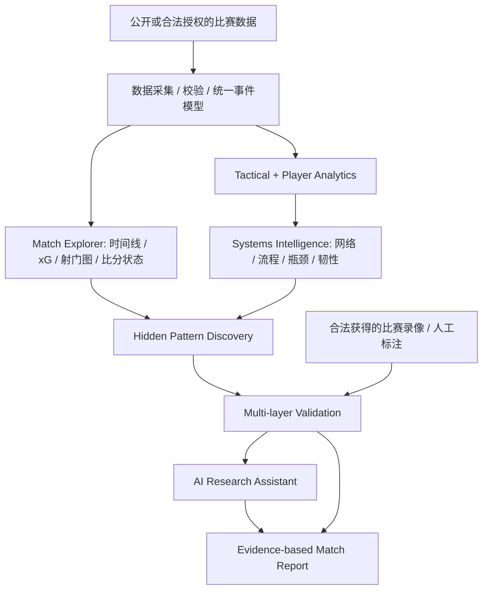

# Football Intelligence Lab
## Product, Research & Technical Reference — v1.0

**Date:** 2026-10-18  
**Status:** Working reference / design specification  
**Concept:** Football Analytics × Supply Chain Analytics × Operations Research × AI-assisted Discovery  
**Language:** 中文为主，保留关键英文技术术语。

---

## 0. 一页结论（Executive Summary）

Football Intelligence Lab（FIL）不是自动写赛后评论的聊天机器人，也不是 FotMob / Sofascore 的简化复制品。它首先是**以事件数据为依据的交互式足球分析平台**，其次是**能够发现、验证隐藏规律的研究系统**。

产品必须遵循以下顺序：

1. **Match Reconstruction & Visualization**：准确描述比赛走势、关键时段、射门质量和场上事件。
2. **Tactical & Player Analytics**：研究传球网络、攻防转换、空间推进、球员角色和整体战术组织。
3. **Systems Intelligence**：从供应链与运筹学引入网络依赖、瓶颈、流程挖掘、系统韧性和节点关键性。
4. **Hidden Discovery & Multi-layer Validation**：主动发掘关键但被忽略的球员、异常战术规律、潜在低贡献环节，并进行多层验证。
5. **AI Research Assistant**：在可追溯的统计计算之上提出解释、反证、录像复核任务及文字报告，**不得编造数据**。

**中心研究问题：**

> How do individual players and tactical structures influence the efficiency, resilience, and performance of a football team's attacking and defensive systems?

> 球员与战术结构如何共同影响一支球队的进攻、防守效率、系统韧性和整体表现？

**核心产品原则：先可视化事实，再发现模式，之后解释与验证。**

---

## 1. 产品要解决什么问题

### 1.1 用户希望获得的体验

打开一场比赛时，应首先看到**交互式 Match Explorer**，不是 AI 长篇点评。用户可以：

- 理解比赛每个时段的节奏与威胁变化，识别转折点；
- 点击时间窗口，联动查看射门、xG、传球、推进、攻防转换、人员及比分状态；
- 研究双方战术结构和球员之间的连接关系；
- 找出常规数据（进球、助攻、传球成功率）可能遗漏的重要贡献；
- 查看自动生成的“异常候选发现”，沿证据链逐层检验，而不是直接相信评分。

### 1.2 产品差异化

| 常规足球网站侧重 | FIL 要增加的能力 |
|---|---|
| 比分、xG、球员评分、事件图 | 事件驱动的可交互比赛重建与多图联动 |
| 单项球员 KPI 排名 | 同位置、同角色、同比分环境下的多维贡献比较 |
| 静态传球网络 | 分时段动态网络、重要节点、替代路径与网络韧性 |
| 总计进攻次数 | 按单次球权构建的 Process Mining 与价值转化链 |
| 赛后评论 | 支持/反对证据并列的 AI 研究与核查工作流 |

**不做：** 用一个模糊的“AI Score”无解释地给球员下定论；用比赛结果反推战术优劣；没有实际数据却声称还原全部无球跑动。

---

## 2. 四层功能架构



### Layer 1 — Match Reconstruction

必须呈现：

- 比分及事件时间线：进球、换人、红黄牌、射门及重要球权事件；
- **累计 xG 曲线**及分时段 xG / 射门质量；
- **Momentum / Threat Timeline**：根据明确定义的时间窗内 xG、xT 或进攻序列威胁计算，禁止使用不透明的主观分数；
- 射门地图（位置、xG、射正、进球、射门方式）；
- 进攻区域分布、推进通道、控球序列长度、危险球权回收与转换速度；
- **统一时间筛选器**：例如选择 30–45 分钟，所有图表和球员/战术数据同步切换；
- **比分状态**：平局、领先、落后时分开展示，并可按换人前后分段。

### Layer 2 — Tactical & Player Analytics

- **Passing Network**：完成的传球联系、位置与方向；按比赛阶段动态生成；
- **Progression / Territory**：推进传球、带球、最终三区进入、进入禁区、左右侧差异；
- **Shot & Chance Creation**：射门质量、创造者、助攻前的关键动作及价值链；
- **Pressing / Defense**：有压力事件、防守动作、回收球权位置、PPDA 等（仅在拥有足够口径的数据时计算）；
- **Player Contribution Profiles**：推进、机会创造、球权价值、防守、参与率、风险、稳定性和战术角色。

**限制：** 事件坐标不能等同于实时 tracking。没有连续球员位置数据时，不能肯定地重建 22 人阵型、真实压迫覆盖或某球员的全部无球贡献。

### Layer 3 — Hidden Discovery

系统主动提出**待验证候选发现**，例如：

- 传球成功率低但每次接球能产生高推进价值的球员；
- 进球助攻不突出，却持续连接后后场与进攻三区的球员；
- 看似控球占优、实则每次控球创造的机会质量低的阶段；
- 某名球员下场或被限制后，进攻连接结构明显变脆弱；
- 某条进攻线路重复出现，却容易在固定区域中断；
- 高触球/高传球成功率并未转化为可观察贡献的**待复核球员**。

“Underrated”与“Low Contribution”均是**研究候选标签**，不是对球员态度、努力程度或能力的最终判决。

### Layer 4 — Multi-layer Validation + AI

对于每一条发现，至少执行：

1. **Metric cross-check**：多个独立指标是否指向一致方向？
2. **Role & context adjustment**：位置、上场时间、球队打法、对手、比分状态、红牌、比赛阶段是否造成偏差？
3. **Historical baseline**：同球员历史、同位置/相近角色球员、其他比赛是否复现？
4. **Uncertainty**：样本量、置信区间/Bootstrap、异常值和多重比较问题；
5. **Video/event audit**：回到具体动作 ID、事件时间，必要时人工观看录像；
6. **Counter-hypotheses**：至少给出另一种合理解释和能够推翻当前发现的证据。

AI **不得**自行补充未经计算的数据、把相关性写成因果、把事件时间视作精确视频时间或将预测当作观察事实。

---

## 3. 供应链与运筹学的关键交叉方法

### 3.1 Network Analysis（网络分析）

**供应链映射：** 配送节点 / 路径 / 网络连通性 → 球员 / 传球线路 / 可达进攻区域。

可计算：

- Weighted degree / strength：球员传球联系的次数或权重；
- Betweenness centrality：节点在**给定网络定义下**位于多少关键路径上；
- Edge importance：特定传球线路的重要程度；
- Community detection：是否存在局部组合与分组；
- Network density / reciprocity：连接密度与双向流动；
- Time-varying graphs：领先前后、换人前后的网络变化。

**关键问题：** 谁是球队出球枢纽？哪条线路被反复使用？某个球员或区域一旦受限制，是否有替代路径？

> **注意：** 节点移除仅是静态或模拟网络的压力测试，不是“真实让球员下场后球队就会如何”的因果预测。

### 3.2 Bottleneck Theory（瓶颈理论）

把进攻拆分为夺回球权 → 第一阶段出球 → 中场推进 → 最终三区进入 → 禁区行动 → 射门。检查哪个环节耗时过多、失误偏高、输出率偏低。

指标例子：

- 不同阶段的转化率和平均所需动作数；
- 各区域球权丢失的条件概率；
- 进入最终三区后形成射门/高 xG 机会的概率；
- 特定球员或线路承载的流程比例。

**谨慎：** 回传不必然是无效行动，也可能是吸引逼抢、控制风险或改变进攻侧重点。

### 3.3 Process Mining（流程挖掘）

**分析单位是 possession（单次控球），不是比赛全场均值。**

每条控球序列可包含：起点、回收方式、参与球员、动作类型、场上路径、持续时间、推进距离、终止方式、最终 xG / 其他威胁估计。

研究问题：

- 哪些常见进攻序列稳定创造高价值机会？
- 快速转换 vs 阵地组织的效果是否受比分状态影响？
- 特定动作链何处容易中断？
- 某位球员是否经常承担关键的“连接步骤”，虽然不是最后传球者？

可从自定义 possession pipeline 起步；以后评估 PM4Py，前提是流程定义合理且数据足够。

### 3.4 Network Resilience（系统韧性）

构建关键节点/线路的鲁棒性测试：

- 关键球员节点移除或降低连接权重后的网络连通性变化；
- 替代路径数、路径长度变化与到达危险区域的可能性；
- 对比不同时间窗与不同比赛，减少单场偏差。

**解释边界：** 静态节点干预不是现实中的换人实验；对手行为、教练调整与替补风格都可能改变网络。

### 3.5 Optimization（优化）

后期研究候选：在不同约束下寻找更有效的传递路线/选人组合；以约束优化和情景分析为主，不提前宣称能输出真实世界最优战术。

---

## 4. 球员贡献分析：识别 Underrated / Low-Contribution Candidates

| 维度 | 推荐指标 / 观察 |
|---|---|
| Progression | Progressive passes/carries、最终三区进入、推进距离、每次触球推进价值 |
| Chance creation | xA（需注明定义）、关键传球、射门前动作链、机会创造质量 |
| Possession value | xT、VAEP（模型条件允许时）、丢球损失、负向动作价值 |
| System criticality | 加权中心性、桥梁作用、替代连接稀缺性 |
| Defensive | 回收球权、抢断/拦截、防守区域、压力下处理质量 |
| Efficiency & risk | 每 90 分钟及每次参与价值、成功率、风险承担 |
| Role adjustment | 同角色球员比较、球队体系和比分状态校正 |
| Consistency | 跨场次复现、置信区间、时间趋势 |

**避免的误判：**

- 把“传球成功率高”直接等同“贡献高”；
- 把“触球少 / xT 低”直接等同“划水”；
- 把进球或评分低直接等同“表现差”；
- 忽略球员在场上的职责、无球空间创造、对手战术和样本规模。

**合理输出应是：**

> *Player X is flagged as a potential underrated connector because his progression contribution and network dependency are high relative to comparable midfielders. This conclusion remains provisional until role adjustment, multi-match checks and video review.*

---

## 5. 数据源与可获得性

### 5.1 首选研究数据

- **StatsBomb Open Data**：https://github.com/statsbomb/open-data （亦可从 Hudl 维护的开放数据仓库访问）。适合历史比赛事件分析；只有特定比赛提供开放事件及可选的 360 数据。
- **socceraction**：https://socceraction.readthedocs.io/ — 可研究 SPADL / xT / VAEP 实现、定义和限制。
- **mplsoccer**：https://mplsoccer.readthedocs.io/ — 球场图、事件可视化等。
- **FotMob / Sofascore / 赛事官方 match centre**：适合人工查看实时/赛后汇总数据；程序使用、自动采集和再分发需尊重许可与服务条款。
- **合法获得的完整比赛回放**：提供动作环境、无球和战术细节，但转播镜头可能遗漏场外球员位置。

### 5.2 分级数据能力

| 数据层 | 可实现 | 不能可靠完成 |
|---|---|---|
| 汇总统计 | xG/射门/控球走势初览 | 逐传球过程、完整传球网络 |
| 事件级数据 | 动作与坐标、传球线路、控球序列、进攻价值 | 连续 22 人无球空间定位 |
| 360 / 局部空间数据 | 指定事件时刻的部分空间分析 | 完整连续 tracking |
| 连续 tracking / 授权战术录像 | 更深入的空间、压迫、跑动分析 | 仍需验证因果与数据准确度 |

**本项目的真实限制：** 不能假定 2026 年 10 月 18 日 Brighton vs Crystal Palace 的完整逐事件与 tracking 数据已公开。历史 StatsBomb 比赛只能用于方法开发，不能冒充布莱顿当日赛事分析。

---

## 6. 当前原型状态与工程警戒线

### 6.1 已有原型：v0.2

已用 StatsBomb 开放历史比赛跑通 Notebook，并生成 `evidence_packet.json`。示例为 2018 世界杯决赛 France vs Croatia（match_id 8658），不是布莱顿比赛。

当前证据包包含：事件总数、球队 xG、基础 xT 排名、分时段事件摘要、部分传球网络边。该结果证明**数据读取和初步统计**可运行，但**不表示系统已具备完整战术或球员发现能力**。

### 6.2 已暴露的技术问题

- 起初的球队名称字段解析与 StatsBomb JSON 结构不匹配，已修改匹配逻辑；
- 单个汇总 `evidence_packet.json` 不足以深入重建所有传球、球权流程及录像片段；
- 自定义 xT 依赖参考网格、动作定义和成功/失败过滤，**必须校验**；
- 初版比赛分段统计需核查原始事件抽取、区间定义和事件计数口径；
- 不能把 under_pressure 事件个数直接解释为逼抢成功或防守效果；
- AI 解释应在可靠指标计算之后，而非替代计算。

### 6.3 数据质量契约（Data Contracts）

所有图表和模型指标应保留：

- `match_id`, `competition_id`, `season_id`, `source` 和许可信息；
- 事件 `event_id`, 球队、球员、分钟/秒、period、动作类型、坐标、结果；
- 比赛时间、补时及坐标方向的统一定义；
- 成功/失败传球口径、非比赛动作过滤、乌龙球/点球处理；
- 指标计算版本、参数、生成时间、缺失比例；
- 事件到图表点、图表点到原始记录的可追溯链接。

---

## 7. 推荐技术架构

```text
football-intelligence-lab/
├── data/
│   ├── raw/                   # source-preserving, licensed input
│   ├── interim/               # standardized events, possessions
│   └── processed/             # validated metric tables
├── src/
│   ├── ingestion/             # source adapters, schemas, provenance
│   ├── metrics/               # xG, xT, xA, progression, defensive proxies
│   ├── possessions/           # possession segmentation, process metrics
│   ├── networks/              # time-window graphs, centrality, resilience
│   ├── discovery/             # anomaly scans, baselines, candidate ranking
│   ├── validation/            # robustness, uncertainty, evidence checks
│   ├── visualization/         # pitch maps, timeline, comparisons
│   └── agent/                 # evidence retrieval and writing only
├── app/                       # interactive dashboard
├── tests/                     # unit tests + fixture regression tests
├── reports/                   # charts, evidence packets, claims
└── docs/                      # definitions, decisions, limitations
```

| 层 | 建议工具 | 说明 |
|---|---|---|
| Data | Python, Pandas, DuckDB | 可先在 Colab 跑通；大数据量再扩展 |
| Actions/metrics | socceraction, NumPy, SciPy | 首先严格确认数据与指标口径 |
| Network | NetworkX | 连通性、中心性、动态切片和压力测试 |
| Process | 自定义 possession pipeline；可选 PM4Py | 避免直接套用不匹配的工业流程定义 |
| Statistics | SciPy, statsmodels, Bootstrap | 置信区间、比较与稳健性 |
| Visualization | mplsoccer, Plotly, Streamlit | 先打磨可探索的比赛 Dashboard |
| Agent | 可选云端 LLM API + 函数工具 | 只对验证过的数据做解释与检索；非 MVP 前置依赖 |

**运行环境：** 首先使用 Google Colab / 自己的 Mac；BC Engineering Room 100 禁止安装未经授权软件，不应通过换包管理器绕过限制。该足球分析项目初期也**不需要 RTX 5070**。

---

## 8. 产品路线图与验收标准

### v0.3 — Match Explorer（最高优先级）

**交付：** 一个可交互的比赛页面，包含比分与事件时间线、累计 xG、按时间窗 threat 图、射门地图、球权序列基础统计。所有组件使用统一时间过滤器。

**验收：**

- 用真实、可授权使用的比赛事件数据完整呈现 90 分钟与补时；
- 点击任意 15 分钟区间，所有图表和统计同时更新；
- xG 汇总等于逐次射门 xG 总和（容忍浮点误差），事件计数可回查；
- 每个图表明确数据来源、指标定义和限制；
- 时间区间切换不把补时、半场边界混入错误区间。

### v0.4 — Tactical Dashboard

**交付：** 动态传球网络、位置/推进热区、比赛阶段比较、球权恢复与攻防转换分析。

**验收：** 网络边能回查到传球事件 ID；网络权重与时间筛选一致；不将数据不足的空间判断包装成确定事实。

### v0.5 — Player Intelligence

**交付：** 多维球员贡献画像、按 90 分钟和参与次数校正的指标、同位置/角色比较；首版 Underrated Candidate 列表。

**验收：** 每个标记都附证据指标、合理反解释、最小样本要求；不将标记直接称为“划水事实”。

### v0.6 — Systems Discovery & Validation

**交付：** 网络关键性、进攻流程挖掘、瓶颈定位、网络韧性压力测试；自动生成候选规律并开展跨指标/跨比赛验证。

**验收：** 至少三种独立证据来源/视角；控制比赛情境；能给出不确定性与反证；记录候选筛选数量以警惕多重比较。

### v0.7 — AI Analyst

**交付：** AI 根据可追溯证据包提出解释、查找反证、生成录像待复核事件列表与研究报告。

**验收：** 每条数字结论可溯源到计算结果；不会将推断写成既定事实；遇到缺失数据主动说明。

### v1.0 — Brighton Intelligence

**交付：** 在**合法可获得的数据范围内**分析布莱顿具体比赛；可以先使用基础统计和人工标注，再逐步提高数据粒度。

**验收：** 清楚标明数据层级和可信范围，不混用 2018 历史开放赛数据与 2026 布莱顿比赛。

---

## 9. 首次研究设计（MVP）

**研究主题：** 谁是球队进攻组织的隐藏关键节点？

**假设：** 传统 KPI 不突出的球员，可能因网络连接、推进路径和进攻序列参与，对整体进攻流程有重要作用。

**分析步骤：**

1. 从 StatsBomb 历史比赛提取**全部完成传球事件和动作位置**；
2. 以 15 分钟区间或关键比分时点切分传球网络；
3. 计算传球联系、中心性、推进贡献和球权序列参与；
4. 在同角色球员之间比较，避免直接用原始总次数排名；
5. 做节点/线路弱化的网络压力测试，记录连通性变化；
6. 检查跨时段、跨比赛稳定性，并人工复核有争议的动作；
7. 输出候选球员及其支持、反对证据和局限。

**产出：**

- Match Momentum + xG Dashboard；
- Interactive Passing Network；
- Top Hidden Connector Candidates（附证据，不是最终评判）；
- Possession Flow / Bottleneck Summary；
- Evidence-backed Research Notes。

---

## 10. AI Agent 的具体职责与禁止事项

### 允许与鼓励

- 调用数据库查询与**预先定义**的统计函数；
- 主动扫描异常并提出多个竞争假设；
- 将每个发现映射到事件 ID / 球员 / 比赛分钟和相关指标；
- 建立支持证据、反证、置信程度与待人工检查项；
- 生成图表说明、战术研究笔记和可供复核的报告。

### 不允许

- 凭语言直觉捏造 xG、xT、跑动距离、压迫强度或比赛片段；
- 使用单场样本断言球员长期能力；
- 把中心性相关性误称为球员对胜利的因果贡献；
- 声称仅凭广播镜头即可连续定位 22 人；
- 用历史 StatsBomb 数据冒充不存在的当场数据；
- 对未经授权的商业比赛内容进行违规抓取或传播。

### 研究发现输出 Schema（建议）

```json
{
  "finding_id": "example-001",
  "match_id": "source-specific-id",
  "title": "Potential overlooked connector",
  "observation": "Measured pattern with clear unit and comparison group",
  "supporting_evidence": [{"metric": "...", "value": null, "source_event_ids": []}],
  "counter_evidence": [],
  "confounders": ["role", "game_state", "opponent"],
  "uncertainty": "sample-size and robustness note",
  "video_review": [{"event_id": "...", "approx_match_minute": null}],
  "status": "candidate_pending_review"
}
```

---

## 11. 决策原则（长期保持）

1. **Visualization first, narratives later.** 先把比赛变成可以观察的数据。
2. **Event-level traceability.** 每一个洞见都可以追查原始事件。
3. **Systems over isolated KPIs.** 同时考虑个人表现和系统作用。
4. **Role-adjusted comparison.** 不按一个统一分数审判全部球员。
5. **Multiple explanations.** 每个有趣发现都应接受反证。
6. **No causal overclaim.** 压迫、换人、节点移除等分析谨慎处理因果。
7. **Data provenance & rights.** 历史样本、当前比赛、商业数据严格区分。
8. **AI is the analyst assistant, not the source of truth.** 计算与证据优先。
9. **Build an explorable product, not just reports.** 交互体验是核心交付。
10. **Start narrow, validate deeply.** 先做一个可复现的高质量比赛研究，再扩大赛事覆盖。

---

## 12. 下一步开发任务（明确行动）

**立即启动 v0.3 Match Explorer，而不是继续增加 AI 评论提示词。**

1. 保留完整原始事件表，修正并测试 match / team / player / possession 字段标准化；
2. 实现 `match_timeline`、`shots`、`xg_cumulative`、`window_threat` 四张核心事实表；
3. 建立共享时间筛选器，完成事件时间线、累计 xG 和射门地图；
4. 为每个数字增加来源字段、定义解释和单元测试；
5. 然后开发传球网络和 possession segmentation；
6. 最后引入自动 Discovery 与 AI Analyst。

**第一个里程碑的成功标准：** 用户打开一场比赛，在 30 秒内看懂比赛的走势；点击任意关键时段，可以看到具体是什么事件、球员和进攻线路推动了变化，并能回查数据。

---

*本文件为 2026-10-18 讨论后形成的产品与技术参考规范。前述技术设想与研究方案是设计决策，不等于已经实现或完成实证验证。具体数据许可、可用比赛及模型兼容性需要在实施时进一步确认。*
