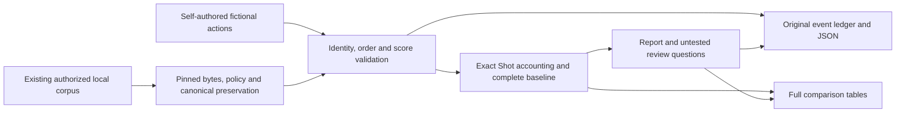

# Match Intelligence MVP — implementation and integration

## Product boundary

A selected match flows through local source validation → deterministic calculations → a bounded
report → original evidence and baseline inspection. There is no external AI call, learned
model, orchestration service, new data acquisition, database or deployment. The existing pinned
Streamlit, Plotly and PyArrow dependencies are sufficient; the dependency lock is unchanged.

The data path is an ordinary Python call inside the local Streamlit session. UI state travels
through its WebSocket; there is no separate REST service or hidden generative pipeline.

## Modules and contracts

- `fil.intelligence.demo`: deterministic, self-authored fictional fixtures. No real names,
  provider records or fitted/calibrated probabilities. It uses provider-shaped fields to exercise
  the same arithmetic, while provenance and UI label its values as illustrative weights.
- `sources`: default fictional catalog, explicit offline library preparation and real-data
  adapter. The reference bundle verifies against committed upstream pins. Additional matches
  use the existing exact approved enumeration and per-match quality/canonical artifacts.
  Original metadata, accepted metric policy, canonical preservation and source hashes are checked.
- `engine`: no UI calls and no input mutation. Reuses the tested source-order score reconciler,
  including own-goal perspectives and separate shootouts. Exact Decimal sums preserve source
  precision. Every selected match-play Shot enters the baseline. Missing weights block accounting
  cards and sums rather than becoming zero. Unresolved membership remains excluded and enumerated.
- `app`: match selection and explicit execution, shared team/period scope, dynamic report,
  evidence workspace and baseline/limits workspace. Full original match-play score is persistent.
  Opening a membership deliberately shows whole-source context, visibly distinct from filtered
  foreground actions. Changing match withholds the previous match's report until execution.
- CLI: loopback-only, telemetry disabled, demo is the explicit default even when an inherited
  research environment variable exists. Real mode requires an operator-supplied local library.

The three report cards are a **display page size** sorted by native-membership Shot-weight sum.
All memberships remain in the complete baseline. This is a review convenience, not a significance,
football-relevance, novelty, pattern validation or generalization criterion. Arithmetic deletion
never simulates an alternative football match. Repeated Shots in one membership do not establish
repeated tactical behavior. Untested alternatives stay questions/hypotheses, not factual explanations.

## Cache and failure behavior

Every real-data rerun hashes the selected source/quality bytes plus pinned reference files.
The hash is part of the bounded read-only payload cache key. A cache hit never bypasses change
detection. Changed input forces complete selected-match verification; failure stops the report.
No mtime-only shortcut is used. The combined corpus Parquet is not a runtime analytical input:
selected immutable raw JSON and independently verified per-match canonical preservation are.

The library binds corpus manifest/quality and reference manifest identities. Runtime source,
order and score gates remain mandatory. Exact physical time and direction are not used or certified.
A blocked library does not silently fall back to a demo. Real-data exports are not offered;
fictional JSON export is labelled separately. Error, loading and empty states are covered.

## Safe integration strategy

Observed on 2026-10-26: **18 open draft PRs**, none merged (#4–8, #10–22). PR #22 head is
`d5eb2189f90777149dbb0501f6b2e22bbd7fe0a1`; its hosted PR CI run
[40040322538](https://github.com/Qiao527/football-intelligence-lab/actions/runs/40040322538)
was completed successfully. This is parent evidence, not MVP CI evidence. The current feature
branch starts exactly there. Existing heads/bases were inspected read-only through GitHub.

1. Keep historical heads/bases, artifacts and merge restrictions unchanged. No retarget,
   rebase, squash, force push or direct main push is part of this sprint.
2. Keep MVP code, tests and product documentation in bounded commits on
   `feat/fil-match-intelligence-mvp`. Review its diff against the exact parent SHA, not main.
3. Run all existing checks and independent real-source reconciliation. Hosted validation is
   recorded separately. Do not call a green parent or branch run a main integration check.
4. Before any owner-approved release integration, inspect current main and the complete runtime
   dependency closure. Main lacks layers used by this MVP: cherry-picking only its UI is not a
   runnable release. Prepare a dedicated integration diff with dependencies, preserve original
   refs, rerun full source/product checks and satisfy actual branch requirements.
5. Historical merges, retargeting and public deployment remain owner actions. No additional
   research PR is needed to demonstrate product work. The branch is runnable now; main release
   readiness and human acceptance are separate.

Risks: long dependent history, current-base CI not proving future main compatibility, divergent
legacy integration ancestry and unresolved enforcement/reviewer arrangements. Branch protection
was not modified or newly certified by this sprint. Previously documented plan restrictions
must not be bypassed. No request to purchase or activate a plan is repeated here.

## Deliberately bounded MVP

No ratings, trained action values, causal attribution, new source, independent discovery claim,
agent framework or new dashboard collection. The existing four-view app is preserved. Its
historical cold-start/long-tail latency issues remain visible in `STABILIZATION_REPORT.md`;
the smaller MVP workload is not evidence those issues were fixed. New browser measurements
retain all samples and distinguish source execution from total startup/rendering.
